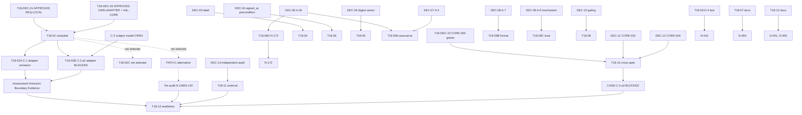

# Remediation Roadmap — Task 18

**Audit base:** `2a83c65`. **Planning only.** `T18-DEC-01` and `T18-DEC-02` are approved; no implementation task is executed. `T18-02A` is eligible; `T18-02B` is BLOCKED on the C-2 model; `T18-02C` is not selected.

## 1. How to read this roadmap

- `Task priority` is remediation urgency. `Requirement priority` is in `disposition-matrix.md`.
- Conditional tasks are valid only after their decision resolves ownership.
- A task is closed only by the evidence named in its acceptance criteria, not by the existence of a plan.
- Task 18 does not edit `docs/CORE-001.md`; normative amendments go through `T18-SPEC-01`.

## 2. Approved decision outcomes

`T18-01` is complete:

- `T18-DEC-01` = **`REQ-LOCAL`**: local Assessment recording required for `PARENT_UNRESOLVED` and `CYCLE_DETECTED`.
- `T18-DEC-02` = **`OWN-ADAPTER` + `VAL-CORE`**: adapter constructs/registers; Core validates; validation is enforced at registration.

| Status | DEC-01 | DEC-02 | Eligible remediation |
| --- | --- | --- | --- |
| **Approved** | `REQ-LOCAL` | `OWN-ADAPTER` + `VAL-CORE` | `T18-02A` eligible; `T18-02B` blocked on C-2 model; `T18-02C` not selected |
| Alternative (not selected) | `REQ-LOCAL` | `OWN-CORE` | `PATH-A`; not active |
| Alternative (not selected) | `REQ-EXTERNAL` / `REQ-NONE` | n/a | `PATH-C`; `T18-SPEC-01` only |

**Path correction:** `VAL-CORE-CONSTRUCTION` is only compatible with `OWN-CORE`. It is not a valid option under `OWN-ADAPTER`. The selected validation path is `OWN-ADAPTER` + `VAL-CORE`, enforced at registration or through a guarded validated-registration API.

### Assessment Emission Boundary Evidence (AEBE)

AEBE is a shared deliverable, not a task. It requires:

1. An Assessment produced from graph state with the exact claim: `PARENT_UNRESOLVED` for an orphan, `CYCLE_DETECTED` for a cycle.
2. Negative evidence: a resolved parent produces no `PARENT_UNRESOLVED`; an acyclic graph produces no `CYCLE_DETECTED`.
3. Ownership: the assessment is frozen/registered; the graph and descriptor are unchanged.
4. Boundary authenticity: the evidence comes from the boundary that actually owns emission. A hand-constructed literal in a test is not AEBE.
5. Validation: Core semantic validation is enforced on every supported registration path; malformed assessments are rejected; the old public registration API cannot bypass validation.
6. Public API: the evidence uses the package root; an internal-module import is an API boundary gap.

T18-13 depends on AEBE, not on a specific implementation task.

## 3. Task table

| Task | Type | Includes | Prerequisites | Risk scope | Task priority | Deliverables | Acceptance | Verification |
| --- | --- | --- | --- | --- | --- | --- | --- | --- |
| T18-01 | specification/design | T18-DEC-01, T18-DEC-02; N-138, N-143, C-1, C-2 | none | `CORE-001_RUNTIME` | P1 | Decision record (approved) | DEC-01 = `REQ-LOCAL`; DEC-02 = `OWN-ADAPTER` + `VAL-CORE` | Recorded in `decision-register.md` |
| T18-02A | implementation + tests | N-138, CASE-C-1.a3, T-001 | DEC-01/02 approved; Core validation enforced | `CORE-001_RUNTIME` | P1 | Adapter C-1 emission + Core validation | AEBE for C-1 from adapter; validation bypass closed | `bun test tests/conformance/c.test.ts`; full suite |
| T18-02B | implementation + tests | N-143, CASE-C-2.a2, T-002 | DEC-01/02 approved + C-2 subject-model decision | `CORE-001_RUNTIME` | P1 | Adapter C-2.a2 emission + Core validation | **BLOCKED** until C-2 model approved; AEBE for C-2.a2; C-2 stays BLOCKED | `bun test tests/conformance/c.test.ts`; full suite |
| T18-02C | not selected | — | `OWN-CORE` not selected | `CORE-001_RUNTIME` | — | None | Do not treat as active work | — |
| T18-03 | test-only | N-041, CASE-D-4.a2, T-004 | none | `CORE-001_RUNTIME` | P2 | D-4 policy input/outcome test | No auto-authorization; policy context asserted | `bun test tests/conformance/d.test.ts` |
| T18-04 | conditional | N-019, F-005, T-005 | T18-DEC-03 | `CORE-001_RUNTIME` | P2 | Validation change or caller contract + test | Invalid SEMVER_2 rejected or contract proven | `bun test tests/unit/version-scheme.test.ts`, `entities.test.ts` |
| T18-05 | conditional | N-084, T-011 | T18-DEC-05 | `CORE-001_RUNTIME` | P3 | `verifyDescriptorHash` or caller contract + boundary evidence | Match/mismatch/malformed; negative mismatch | `bun test tests/unit/hashing.test.ts` + caller test |
| T18-06 | specification decision + docs | N-040, F-006, T18-DEC-04 | T18-DEC-04 | `CORE-001_RUNTIME` | P2 | Decision record and proposed wording | Decision record and proposed wording; any normative amendment is routed through separately approved T18-SPEC-01 | Review |
| T18-07 | documentation-only | N-004, D-1, T-014 | none | `CORE-001_RUNTIME` | P3 | Docs limitation + test annotation | No execution claim | Review |
| T18-08 | cross-spec decision/docs | N-079, T-013 | T18-DEC-10 | `AUTHORITY_BOUNDARY` | P3 | Boundary decision + owner | CORE-003/decision layer named | Review |
| T18-09A | specification decisions | N-078, N-107, N-112; T18-DEC-06/07 | none | `CORE-001_RUNTIME` | P1 | A-4b and A-5 decisions | Decisions recorded, not approved by Task 18 | Review |
| T18-09B | specification decision | N-020; T18-DEC-08 | none | `CORE-001_RUNTIME` | P3 | A-7 decision | Grammar decision recorded | Review |
| T18-09C | specification decision | N-128; T18-DEC-09 | none | `EXTERNAL_READINESS` | P2 | Trusted-time requirement definition | Normative requirement before external mechanism | Review |
| T18-09D | specification decision | N-172; T18-DEC-06 | T18-09A (A-4b decision) | `CORE-001_RUNTIME` | P2 | N-172 readiness evidence decision | Conflict tests only after approved predicate | Review |
| T18-10 | cross-spec integration | N-026, N-145, N-156, N-169, N-174; T18-DEC-11/12/13 | receiving owners | `CROSS_SPEC` (N-145 `AUTHORITY_BOUNDARY`) | P3 | Handoff records | Receiving spec and acceptance criteria named | Review |
| T18-11 | external | N-170, N-175; T18-DEC-14 | none | `EXTERNAL_READINESS` | P3 | External audit plan | Independent evidence criteria defined | Review |
| T18-12 | documentation-only | D-001…D-008 | audit acceptance | `CORE-001_RUNTIME` | P3 | Corrected `docs/implementation.md`/plan statuses | No Task 17 edits | `bun run format:check` (docs excluded) + review |
| T18-13 | readiness/test | N-168 | AEBE (or T18-SPEC-01 re-audit outcome), T18-10, T18-11 | `EXTERNAL_READINESS` | P1 | Readiness evidence record | READY / CONDITIONALLY_READY / NOT_READY per §6 | Review of evidence |
| T18-SPEC-01 | specification | Any decision requiring a CORE-001 amendment | T18-DEC approval | `CORE-001_RUNTIME` | P2 | Separate spec change | Approved amendment and re-audit | Spec review + re-audit |

## 4. Detailed task notes

### T18-01 — Assessment-emission decision package (complete)

The project owner approved `T18-DEC-01 = REQ-LOCAL` and `T18-DEC-02 = OWN-ADAPTER + VAL-CORE`. The approved record is in `decision-register.md`. This task is not an implementation task.

### T18-02A — C-1 adapter emission (eligible)

The adapter constructs/registers the C-1 Assessment using domain identity, provenance and time. Core semantic validation must be enforced at registration (inside `registerAssessment` or via a guarded validated-registration API). AEBE must come from the adapter boundary, not a hand-constructed fixture. T18-02A closes N-138/C-1.a3 only.

### T18-02B — C-2.a2 adapter emission (BLOCKED)

The adapter path is selected, but the C-2 subject model (SCC, node, or edge) is still OPEN. T18-02B cannot begin until that separate decision is approved. It closes N-143/C-2.a2 only; it does not close C-2 and does not close N-168.

### T18-02C — Not selected

`T18-02C` is not the selected ownership path and must not be treated as active work. It remains a historical option only.

### Validation enforcement

Core validation is mandatory on every supported registration path. A standalone validator that callers can bypass is insufficient. The implementation may choose validation inside `registerAssessment` or a guarded validated-registration API, provided the old public API cannot bypass validation.

### T18-05 — Digest verification

If `T18-DEC-05` assigns verification to CORE-001, add `verifyDescriptorHash` with match, mismatch and malformed-input tests. If it assigns verification to callers, the closure requires:

- an explicit caller contract with the exact comparison rule;
- evidence that the caller boundary performs the comparison;
- negative mismatch evidence (tampered descriptor or wrong claimed digest rejected).

Documentation alone does not close N-084.

### T18-13 — Readiness closure evidence

T18-13 consumes AEBE, the C-2 a3 disposition and T18-11 external evidence. It does not depend on a specific implementation task. Readiness outcomes are defined in §6.

### T18-SPEC-01 — Specification change

Any decision that requires a normative amendment goes here. Task 18 decision packages may record the decision and prepare a proposal; they cannot edit `docs/CORE-001.md`. T18-SPEC-01 requires separate approval and a re-audit of affected Task 17 items.

## 5. Dependency graph

## 6. Milestones, critical path, readiness

### Milestones

- **M0** — DEC-01 (`REQ-LOCAL`) and DEC-02 (`OWN-ADAPTER` + `VAL-CORE`) approved; C-2 model still OPEN.
- **M1** — CORE-001 implementation/evidence gaps resolved or explicitly dispositioned (T18-02A eligible; T18-02B blocked; T18-02C inactive; T18-04, T18-05).
- **M2** — evidence gaps closed (T18-03, T18-07).
- **M3** — cross-spec packages accepted (T18-08, T18-10).
- **M4** — readiness and external evidence (T18-11, T18-13), documentation reconciliation (T18-12).

### Critical path

1. **C-1:** DEC-01/02 approved → T18-02A (adapter C-1) → AEBE → T18-13; readiness also needs T18-11 for N-170/N-175.
2. **C-2:** C-2 subject-model decision → T18-02B (adapter C-2.a2) → AEBE; plus T18-DEC-13/T18-10 for a3 → T18-13.
3. **Assurance:** T18-DEC-06/07 → T18-09A → N-078/N-107/N-112; T18-DEC-06 → T18-09D → N-172.
4. **Trust:** T18-DEC-04 → T18-06 → N-040; T18-DEC-09 → T18-09C → N-128.

### Readiness outcomes (N-168)

| Outcome | Criteria |
| --- | --- |
| `READY` | All §16 criteria PASS; C-1 PASS; C-2 PASS; T18-11 completed and N-170/N-175 confirmed; no accepted limitation affecting CORE-001 runtime conformance |
| `CONDITIONALLY_READY` | C-1 PASS; AEBE for N-143/CASE-C-2.a2; C-2 BLOCKED only on explicitly accepted CORE-003 dependency (CASE-C-2.a3); T18-11 external dependency explicitly accepted with impact described; all other §16 criteria PASS or explicitly accepted; limitations, dependencies and impact enumerated; no CORE-001 implementation gap |
| `NOT_READY` | Any C-1/C-2 assertion unverified beyond an accepted cross-spec limitation; any CORE-001 implementation gap; unaccepted limitation; required independent compatibility evidence absent and not accepted as a limitation |

An approved BLOCKED disposition does not imply readiness. `T18-DEC-01` is approved as `REQ-LOCAL`; the `PATH-C` alternatives are not selected. Readiness still depends on AEBE, T18-10 and T18-11.

## 7. Priority reconciliation

`Requirement priority` and `Task priority` are separate. They are aligned in this roadmap:

- N-020 P3 / T18-09B P3.
- N-084 P3 / T18-05 P3.
- N-128 P2 / T18-09C P2.
- N-078, N-107, N-112 P1 / T18-09A P1.
- N-172 P2 / T18-09D P2.

A task that bundles requirements of different urgency is split rather than silently elevated. Any future divergence must be recorded with a rationale.

| Task priority | Tasks |
| --- | --- |
| P1 | T18-01 (complete), T18-02A, T18-09A, T18-13 |
| P2 | T18-03, T18-04, T18-06, T18-09C, T18-09D, T18-SPEC-01 |
| P3 | T18-05, T18-07, T18-08, T18-09B, T18-10, T18-11, T18-12 |

`T18-02B` is BLOCKED on the C-2 model; `T18-02C` is not selected. Neither is active P1 work.

## 8. Authority-boundary watchlist

- **N-079** — `AUTHORITY_BOUNDARY`, P3 urgency. Low urgency reflects the CORE-003/decision-layer dependency, not low risk. It cannot be closed by documentation alone.
- **N-145** — `AUTHORITY_BOUNDARY`, P3 urgency. Grant suppression belongs to CORE-003; CORE-001 cannot demonstrate it.

Both require named owners and explicit acceptance. P3 must not obscure their significance.

## 9. Non-goals

- No grant/capability/authority API.
- No new revocation or acceptance semantics.
- No recursive closure or conflict predicate before decisions.
- No constant-`RUNNING` execution test.
- No CORE-001 specification edit inside Task 18.
- No implementation task where ownership is unresolved.

## 10. Verification expectations

Task 18 is documentation-only. Future implementation tasks use the repository's existing commands:

- `bun test` (or targeted `bun test tests/...`),
- `bun run lint`,
- `bun run typecheck`,
- `bun run build`,
- `bun run format:check` (does not cover `docs/`).

Task 18 documents are checked manually for table consistency, ID resolution, and count reconciliation.
