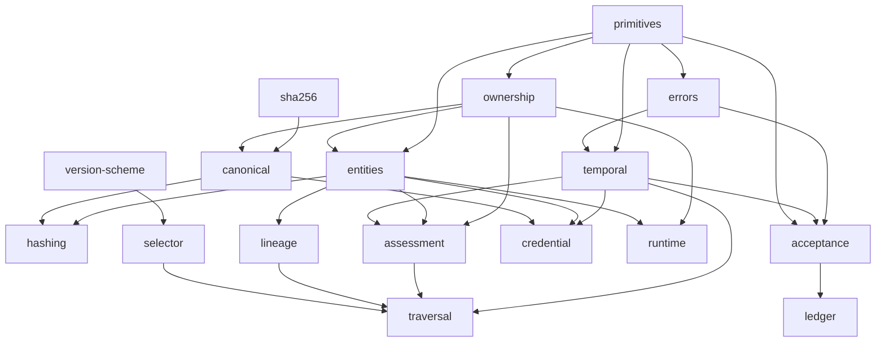

# UIA-CORE-001 — Implementation Reference

**Status:** Evidence-backed description of the repository as of commit `9425d3f` (plus the Task 16 documentation commit).
**Normative source:** [`CORE-001`](./CORE-001.md), UIA-CORE-001 Rev 0.3.3, Candidate Draft Normative.
**Implementation plan:** [`2026-10-30-uia-core-001-implementation.md`](./superpowers/plans/2026-10-30-uia-core-001-implementation.md), Rev E.
**Package:** `uia-core-001-refimpl` 0.1.0.

This document describes what the code in `src/core/` actually does. It is not a restatement of the approved plan and not a second specification. Where the plan, the specification, the source and the tests disagree, the disagreement is preserved and each statement below identifies the source that supports it.

## 0. How to read this document

Four kinds of statements appear here, and they are never merged:

| Kind | Meaning | Typical evidence |
| --- | --- | --- |
| **Normative** | Required by CORE-001 Rev 0.3.3 | Quoted or cited section of `docs/CORE-001.md` |
| **Implementation decision** | A choice the approved plan or the merged code made where the specification is silent or where a mechanism was required | `ID-T##` entry in §5, source comment, commit history |
| **Unresolved assumption** | A gap that remains OPEN or BLOCKED in the Ambiguities Register | `A-##` entry in §6 |
| **Mechanism** | A replaceable way to satisfy a contract; never a protocol truth | §7 |

Two standing rules apply throughout:

1. **Timestamp presence is not timestamp trust.** The core never decides that a declared timestamp is trustworthy because it exists.
2. **No object in this repository creates authority.** There is no grant type, no grant-producing function and no authority inheritance through lineage. `LocalAcceptanceRecord` is a local recognition act, not a grant.

`tests/experimental/` is **excluded from every conformance claim** in this document.

---

## 1. Architecture overview

### 1.1 Purpose and scope

The repository is a pure TypeScript reference implementation of the CORE-001 surface: participants, identity versions, credentials, lineage declarations and their graph, continuity assessments, conditional version binding with traversal, temporal context, runtime instance decomposition and local acceptance.

It is a **reference implementation of one protocol module**, not a distributed UIA runtime. It contains no transport, no envelope, no event ledger format, no authority engine and no evidence model. Those are CORE-002, CORE-003 and CORE-004 boundaries (§14 of the specification) and are represented here only by identifiers and injectable interfaces.

What the implementation does provide:

- immutable, owned domain records with strict boundary validation;
- deterministic lineage graph construction, including delayed parents and cycle components;
- edge-bound assessment applicability and assurance evaluation;
- three separately callable traversal phases with immediate merge closure;
- historical credential evaluation with externally supplied timestamp trust;
- runtime lifecycle decomposition where events never mutate descriptors;
- local acceptance records, a policy-driven lifecycle and a contextual applicability query;
- an in-memory acceptance ledger used only as a test mechanism.

### 1.2 What this is not

- It is **not** a CORE-002 ledger, envelope or delivery implementation. `src/core/ledger.ts` stores acceptance records and lifecycle events in memory; it defines no event format, ordering, replay or persistence.
- It is **not** a CORE-003 authority implementation. No grant, capability, delegation, JIT authorization or taint tracking exists.
- It is **not** a CORE-004 epistemic implementation. There is no `Evidence`, `Finding` or `Ruling` type; evidence is referenced by identifier only.
- It does **not** implement recursive merge closure, conflict detection by default, or a trusted-time mechanism. See §6.
- It does **not** establish that a signature proves identity, intent or authority (§4.1 of the specification).

### 1.3 Layers and boundaries

```text
Host application / domain policy        (outside this repository)
  trusted assessors, policy hooks, signature verifier,
  clock, storage, network, decisions to act
        │  explicit inputs: Policy, TemporalContext,
        │  verifier results, already-validated records
        ▼
Public API — src/index.ts               typed barrel only
        ▼
Domain core — src/core/                 pure functions, owned records,
                                        discriminated results, no runtime APIs
```

| Layer | Responsibility | May depend on |
| --- | --- | --- |
| Domain policy | Chooses trusted assessors, supplies timestamp trust, applies local rules | Public API |
| Public API | Stable typed surface plus `UIA_CORE_001_REVISION` | Domain core |
| Domain core | CORE-001 semantics as pure functions over owned values | Language/WHATWG only |
| Adapters (not present) | Untrusted I/O, crypto, persistence, transport | Public API, runtime APIs |

Boundary rules enforced by configuration, not by convention alone:

- `tsconfig.core.json` typechecks `src/core/**` with `"types": []`.
- `eslint.config.mjs` restricts `node:*`, `bun:*`, bare `node`/`bun`, and the Node core module names under `src/core/**`, and restricts the `process` and `Buffer` globals.
- Cross-module imports inside `src/` use explicit `.js` suffixes, as required by `module: nodenext`.
- No exported API uses `any`. Untrusted input is accepted as `unknown` only at validators, which return `Result<T>`.

### 1.4 Module map

Every module below exists and is exported through `src/core/index.ts`; `src/index.ts` re-exports that barrel.

| Module | Spec | Responsibility |
| --- | --- | --- |
| `core/primitives.ts` | §1, §3, §10 | Branded identifiers, `Timestamp`, strict `JsonValue`, `TemporalFieldRef`, standard temporal fields, lone-surrogate check |
| `core/errors.ts` | §0.2, §12 | `Result<T>`, the eight normative codes, nine mechanism codes, `Failure` union, `CanonicalizationError` |
| `core/ownership.ts` | §3, §13 | `DeepReadonly`, `deepCopy`, `deepFreeze`, `validateUnknown`, strict `validateJsonValue` |
| `core/canonical.ts` | §7.2 | RFC 8785 JCS over the strict data model, `canonicalSha256` |
| `core/sha256.ts` | §7.2 | Pure-TypeScript SHA-256 (`sha256Bytes`, `sha256Hex`) |
| `core/entities.ts` | §3–§5 | §3–§5 records and their boundary validators |
| `core/hashing.ts` | §7.1 | Explicit eight-field descriptor projection, `urn:hash:sha256:…` |
| `core/version-scheme.ts` | §3.2 | `SEMVER_2` validation, non-empty rules for the other schemes, SemVer parsing and precedence |
| `core/selector.ts` | §3.2, §8.2 | Versioned `uia-ref-selector@1` selector mechanism with compiled-selector provenance |
| `core/temporal.ts` | §10 | Temporal contracts and the four-outcome trust derivation |
| `core/assessment.ts` | §6 | Edge-bound applicability, policy narrowing, assurance evaluation, supersession |
| `core/lineage.ts` | §5, §11 | §5.2 structural validation, graph snapshots, delayed parents, SCC cycle detection |
| `core/traversal.ts` | §8 | Path discovery, path validation, immediate merge closure, binding evaluation |
| `core/credential.ts` | §4, §10 | Credential usage, revocation records and reasons, historical signature evaluation |
| `core/runtime.ts` | §3.3, D-1 | Runtime registry, minimal `FAILURE` event, separated `RUNNING` lifecycle state |
| `core/acceptance.ts` | §9 | Immutable local acceptance, policy-driven lifecycle, contextual applicability |
| `core/ledger.ts` | — | Copy-on-write in-memory acceptance/event store — a mechanism |
| `core/index.ts` | — | Core barrel |

Principal module dependencies (not exhaustive; an arrow points from a module to a module that imports it):



`lineage.ts` imports `entities.ts` for types and `ownership.ts` for freezing. `acceptance.ts` imports `primitives.ts` for `TemporalFieldRef` validation. No module imports a runtime API.

### 1.5 Public API boundaries

- `src/index.ts` exports `UIA_CORE_001_REVISION = '0.3.3'` and `export * from './core/index.js'`.
- `src/core/index.ts` re-exports modules through explicit `export *` and named `export` statements. Exported names are typed; no `any` and no unvalidated `unknown` appears in a public record type.
- Module-private brands are **not** exported: `APPLICABLE_ASSESSMENTS_BRAND`, `COMPILED_SELECTOR_BRAND`, `RUNTIME_REGISTRY_BRAND`, `RUNTIME_EVENT_BRAND`, `ACCEPTANCE_LEDGER_BRAND`.
- `ApplicableAssessments` and `CompiledSelector` are exported as types only; their runtime constructors are `assessEdge` and `compileSelector`.
- `RuntimeRegistry` and `AcceptanceLedger` are exported as types; their constructors are `createRuntimeRegistry` and `createAcceptanceLedger`.

### 1.6 Data flow

```text
untrusted input (JSON, transport, storage)
        │
        ▼
validateJsonValue / validateUnknown / module validator   ← may reject
        │  (unknown fields rejected, present-undefined rejected)
        ▼
record construction: deepCopy → deepFreeze               ← owned, immutable
        │
        ▼
pure evaluation (entities, lineage, assessment, traversal,
                 credential, runtime, acceptance)
        │
        ▼
Result<T> = { ok: true; value: T } | { ok: false; error: Failure }
```

Semantic failures are values, not exceptions. There are two deliberate exceptions. `canonicalize` throws `CanonicalizationError` because its return type is a string and it has no protocol-level alternative outcome; `descriptorHashInput` and `descriptorHash` also throw it when re-validation fails. `selectorMatches` throws `InvalidCompiledSelectorError` for a value not produced by `compileSelector`, so a forged selector is never silently treated as valid or as a wildcard.

`evaluateBinding` is the one public evaluator that returns a bare `BindingResult` rather than `Result<…>`; mechanism failures appear inside it as `{ eligible: false, kind: 'MECHANISM', error }`.

### 1.7 Immutable ownership model

- Public record types are written with `readonly` fields; `DeepReadonly<T>` is used at the API boundary and preserves primitive brands.
- Constructors validate, then copy, then freeze. `deepCopy` builds a structurally disjoint graph; `deepFreeze` freezes every reachable object and array and is cycle-safe.
- `deepCopy` rejects, never coerces: functions, symbols, `bigint`, non-`Object.prototype` prototypes (including `Date`, `Map`, `Set`, class instances and null-prototype objects), accessor properties, non-enumerable own properties, symbol-keyed properties, cyclic inputs, sparse arrays and arrays with any own property beyond integer indices.
- `deepCopy` preserves an own `__proto__` key as an own data property via `Object.defineProperty`, rather than triggering prototype assignment.
- Caller mutation after construction cannot reach a stored record. This is tested at module level and in the property suite (P5).
- Historical records are never mutated by later events: revocation does not rewrite a credential or descriptor; a lifecycle event does not rewrite an acceptance record; supersession does not rewrite the predecessor.

### 1.8 Error and result model

`Failure` is a discriminated union on `kind`:

```ts
type Result<T> = { ok: true; value: T } | { ok: false; error: Failure };
type Failure = SpecFailure | MechanismFailure;
interface SpecFailure {
  kind: 'SPEC';
  code: UiaErrorCode;
  message: string;
  details?: Readonly<Record<string, JsonValue>>;
}
interface MechanismFailure {
  kind: 'MECHANISM';
  code: ImplementationErrorCode;
  message: string;
  details?: Readonly<Record<string, JsonValue>>;
}
```

Normative codes (`UiaErrorCode`, exactly eight):
`ERR_INVALID_RELATION`, `ERR_INVALID_CARDINALITY`, `ERR_NO_TRAVERSAL_PATH`, `ERR_MERGE_BRANCH_UNSATISFIED`, `ERR_ASSURANCE_PREDICATE_UNSATISFIED`, `ERR_AUTHORITY_BINDING_MISMATCH`, `CYCLE_DETECTED`, `PARENT_UNRESOLVED`.

Mechanism codes (`ImplementationErrorCode`, nine):
`S_SELECTOR_INCOMPATIBLE_SCHEME`, `E_VERSION_LABEL_INVALID`, `E_SELECTOR_SYNTAX_INVALID`, `E_APPLICABLE_ASSESSMENTS_UNBRANDED`, `E_TEMPORAL_FIELD_REF_INVALID`, `E_CANONICALIZATION_UNSUPPORTED`, `E_OWNERSHIP_UNSUPPORTED`, `E_JSON_VALUE_INVALID`, `E_UNKNOWN_BOUNDARY_REJECTED`.

The split is architectural: a wrong selector scheme is not a statement about a participant, and an unbranded assessment set is not a protocol state. Helpers `isOk`, `isFailure`, `specFailure` and `mechanismFailure` are exported. `PARENT_UNRESOLVED` and `CYCLE_DETECTED` exist as normative codes. After T18-02A, `PARENT_UNRESOLVED` is emitted by the experimental reference adapter and admitted by Core; `CYCLE_DETECTED` remains unemitted because C-2 is BLOCKED.

### 1.9 Runtime portability

`src/core/` imports nothing from `node:*` or `bun:*`, uses no filesystem, process, network, environment or clock API, and uses only language constructs plus `TextEncoder`, `Uint8Array` and `Object`/`Reflect`. Bun is the test and package runtime, not part of the domain. The pure-TypeScript SHA-256 exists so that hashing does not depend on a runtime crypto module; the tests cross-check it against a runtime implementation outside `src/core/`.

### 1.10 Domain entities versus infrastructure

| Kind | Modules |
| --- | --- |
| Domain records and semantics | `entities`, `lineage` (graph), `assessment`, `traversal`, `credential`, `temporal`, `acceptance` |
| Protocol primitives and contracts | `primitives`, `errors`, `version-scheme` |
| Replaceable mechanisms | `selector`, `canonical`, `sha256`, `hashing` (composition), `ledger`, `runtime` registry |
| Test-only constructs | verifier doubles, ledger fixtures, seeded generators in `tests/` |

`runtime.ts` is infrastructure with domain-visible semantics: the descriptor is a domain record, the registry and event are minimal D-1 mechanisms because CORE-001 does not define the CORE-002 event format.

---

## 2. Module and API reference

Signatures below are taken from the current source. Parameter names are part of the signature; optional parameters are marked `?`.

### 2.1 `core/primitives.ts`

**Responsibility:** nominal primitive types and strict temporal field references.

```ts
type Brand<T, B extends string> = T & { readonly __brand: B };

type ParticipantID = Brand<string, 'ParticipantID'>;
type IdentityVersionID = Brand<string, 'IdentityVersionID'>;
type RuntimeInstanceID = Brand<string, 'RuntimeInstanceID'>;
type CredentialID = Brand<string, 'CredentialID'>;
type AssessmentID = Brand<string, 'AssessmentID'>;
type AcceptanceID = Brand<string, 'AcceptanceID'>;
type DomainID = Brand<string, 'DomainID'>;

type Timestamp = number & { readonly __brand: 'Timestamp' };
function timestamp(value: number): Timestamp;

function participantId(value: string): ParticipantID;
function identityVersionId(value: string): IdentityVersionID;
function runtimeInstanceId(value: string): RuntimeInstanceID;
function credentialId(value: string): CredentialID;
function assessmentId(value: string): AssessmentID;
function acceptanceId(value: string): AcceptanceID;
function domainId(value: string): DomainID;

type JsonValue =
  | null
  | boolean
  | string
  | number
  | readonly JsonValue[]
  | { readonly [key: string]: JsonValue };

type TemporalBasis = 'ASSERTED_AT' | 'SIGNED_AT' | 'INGESTED_AT' | 'ASSESSED_AT' | 'DECIDED_AT';
type TemporalFieldRef = TemporalBasis | (string & { readonly __temporalFieldExt?: never });
const STANDARD_TEMPORAL_FIELDS: readonly TemporalBasis[];   // frozen at runtime

function hasLoneSurrogate(value: string): boolean;
function validateTemporalFieldRef(value: unknown): Result<TemporalFieldRef>;
```

**Semantics and invariants**

- Branding is compile-time only. The `timestamp` and identifier constructors are identity casts; they do not validate format. Runtime validation of a timestamp happens in record validators (`typeof === 'number' && Number.isFinite`).
- `STANDARD_TEMPORAL_FIELDS` is `Object.freeze`d and asserted frozen in `tests/unit/ownership.test.ts`.
- `validateTemporalFieldRef` accepts the five standard refs and extension refs matching `^[A-Za-z][A-Za-z0-9_]*(\.[A-Za-z][A-Za-z0-9_]*)*$`. It rejects empty strings, whitespace, C0/C1 control characters and lone surrogates with `E_TEMPORAL_FIELD_REF_INVALID`.
- Standard refs are matched before the extension regex, so a standard name is never treated as an extension.
- Extension refs are validated at each boundary that accepts one: `TemporalContext` consumers (`trustOutcome`, `applyLifecycle`, `isAcceptable`).

**Normative source:** §1 (identity vocabulary), §3 (record identifiers), §10 (temporal references). The extension-ref grammar and the reserved-ref rule are implementation decisions (`ID-T13`), required by Rev E.

### 2.2 `core/ownership.ts`

**Responsibility:** ownership, immutability and the unknown boundary.

```ts
type DeepReadonly<T> = T extends string | number | boolean | bigint | symbol | null | undefined
  ? T
  : T extends (infer A)[]
    ? readonly DeepReadonly<A>[]
    : T extends object
      ? { readonly [K in keyof T]: DeepReadonly<T[K]> }
      : T;

function deepCopy<T>(value: T): Result<T>;
function deepFreeze<T>(value: T): DeepReadonly<T>;
function validateUnknown<T>(value: unknown, guard: (v: unknown) => v is T): Result<T>;
function validateJsonValue(value: unknown): Result<JsonValue>;
```

**Semantics**

- `deepCopy` accepts `null`, `undefined`, string, finite or non-finite number, boolean, plain arrays and plain objects. Numbers are not checked for finiteness here; that is `validateJsonValue`'s job. `deepCopy` and strict JSON validation are deliberately separate.
- Arrays must have `Array.prototype`, no symbol keys, only canonical integer index keys below `length`, no holes, and only data descriptors that are enumerable.
- Objects must have `Object.prototype`, no symbol keys, and only enumerable own data properties. `undefined` values are copied as `undefined` (JSON validation rejects them later).
- `deepFreeze` traverses `Reflect.ownKeys`, so symbol-keyed and non-enumerable properties are frozen too, and it tolerates cycles.
- `validateUnknown` runs the guard first, then copies and freezes. It never casts arbitrary input: a failed guard returns `E_UNKNOWN_BOUNDARY_REJECTED`.
- `validateJsonValue` rejects `undefined` (top-level, property value or array hole), `NaN`, `±Infinity`, functions, symbols, non-plain objects, sparse arrays, arrays with extra own properties, symbol-keyed properties, accessor properties, non-enumerable properties, cyclic graphs and lone surrogates in string values **and object keys**. Rejections use `E_JSON_VALUE_INVALID`.
- Getters are never invoked during validation: descriptors are inspected before values are read.

**Failure modes:** `E_OWNERSHIP_UNSUPPORTED` from `deepCopy`; `E_JSON_VALUE_INVALID` from `validateJsonValue`; `E_UNKNOWN_BOUNDARY_REJECTED` from `validateUnknown`.

**Normative source:** §3 (immutability), §13 #5–#8. The rejection catalogue and the null-prototype rejection are implementation decisions (`ID-T02`).

### 2.3 `core/errors.ts`

**Responsibility:** the result and failure model.

Exports the types listed in §1.8 plus `CanonicalizationError`, `isOk`, `isFailure`, `mechanismFailure` and `specFailure`.

`CanonicalizationError` is a mechanism error carried as a thrown `Error`, not as a `Failure`. No normative code is ever produced for a canonicalization problem.

**Normative source:** §0.2 (normative terminology), §12 (error codes named by the corpus). The exact mechanism-code list is an implementation decision (`ID-T02`, `ID-T05`, `ID-T13`).

### 2.4 `core/entities.ts`

**Responsibility:** the §3–§5 record types and their boundary validators.

**Types**

```ts
type VersionScheme = 'SEMVER_2' | 'CONTENT_HASH' | 'OPAQUE_TAG';
type CredentialUsage = 'AUTHENTICATION' | 'SIGNING' | 'ENCRYPTION';
type LineageRelationType = 'CONTINUATION' | 'FORKED_FROM' | 'MERGED_FROM';
type ParticipantKind = 'HUMAN' | 'AGENT' | 'SERVICE' | 'EXTERNAL_SYSTEM';

interface ParticipantRecord {
  id: ParticipantID;
  kind: ParticipantKind;
  home_domain: DomainID;
  registered_at: Timestamp;
}

interface IdentityVersionDescriptor {
  id: IdentityVersionID;
  participant_id: ParticipantID;
  version_label: string;
  version_scheme: VersionScheme;
  declared_protocols: string[];
  public_credentials: CredentialDescriptor[];
  lineage: LineageLink[];
  published_at: Timestamp;
}

interface RuntimeInstanceDescriptor {
  id: RuntimeInstanceID;
  identity_version_id: IdentityVersionID;
  execution_context_ref: string;
  ephemeral_public_key?: string;
  instantiated_at: Timestamp;
}

interface CredentialDescriptor {
  credential_id: CredentialID;
  issuer_domain: DomainID;
  usage: CredentialUsage[];
  algorithm_family: string;
  public_key_canonical: string;
  not_before: Timestamp;
  not_after?: Timestamp;
  revocation_endpoint_ref?: string;
}

interface LineageLink {
  parent_version_id: IdentityVersionID;
  relation: LineageRelationType;
  declared_rationale?: string;
  continuity_proof_ref?: string;
}

const VERSION_SCHEMES: readonly VersionScheme[];
```

**Validators**

```ts
function validateIdentityVersionDescriptor(value: unknown): Result<DeepReadonly<IdentityVersionDescriptor>>;
function validateParticipantRecord(value: unknown): Result<DeepReadonly<ParticipantRecord>>;
function validateCredentialDescriptor(value: unknown): Result<DeepReadonly<CredentialDescriptor>>;
function validateLineageLink(value: unknown): Result<DeepReadonly<LineageLink>>;
function validateRuntimeInstanceDescriptor(value: unknown): Result<DeepReadonly<RuntimeInstanceDescriptor>>;
```

**Semantics**

- Each validator runs `validateJsonValue`, rejects unknown fields at every level, rejects present-`undefined` optional fields (via strict JSON validation), builds the record and deep-freezes it.
- Validators do **not** enforce normative lineage semantics: cardinality, the CONTINUATION participant constraint, self-parent rejection and version-label grammar belong to `validateDescriptor`, `compileSelector` and `validateVersionLabel`.
- `validateIdentityVersionDescriptor` accepts a descriptor whose parents are not registered. Delayed-parent handling belongs to the graph.
- `credential.usage` is an array of known enum values; duplicates are preserved.
- `VersionScheme` values are validated here; label grammar is not.

**Failure modes:** `E_JSON_VALUE_INVALID` and `E_UNKNOWN_BOUNDARY_REJECTED`.

**Normative source:** §3.1, §3.2, §3.3, §4.2, §5.1.

### 2.5 `core/canonical.ts`

**Responsibility:** RFC 8785 JSON Canonicalization Scheme over the strict data model.

```ts
function canonicalize(value: JsonValue): string;
function canonicalSha256(value: JsonValue): string;
```

**Semantics**

- `canonicalize` first re-validates the value with `validateJsonValue` (callers may cast), then serializes the validated snapshot — never the original object. A `Proxy` cannot change what is serialized.
- Object keys are sorted by UTF-16 code unit comparison. Arrays preserve order. Strings use ECMAScript `JSON.stringify` escaping; numbers use `JSON.stringify` number semantics.
- There is no Unicode normalization: NFC and NFD strings (and keys) remain distinct.
- `canonicalSha256` encodes the canonical string with `TextEncoder` and hashes the UTF-8 bytes.

**Failure modes:** throws `CanonicalizationError` for any value outside the strict data model. It does not return `Result`.

**Normative source:** §7.2 steps 1–2. The strict rejection catalogue is `ID-T03`.

### 2.6 `core/sha256.ts`

**Responsibility:** pure-TypeScript SHA-256.

```ts
function sha256Bytes(input: Uint8Array): Uint8Array;   // 32-byte digest
function sha256Hex(input: Uint8Array): string;         // 64 lowercase hex characters
```

**Semantics:** standard SHA-256 (FIPS 180-4) over the given bytes. No runtime crypto, no Web Crypto, no dependencies. `tests/unit/sha256.test.ts` checks published vectors and cross-checks against a runtime implementation outside `src/core/`.

**Normative source:** §7.2 step 2. The algorithm choice is fixed by the specification; this particular implementation is a replaceable mechanism (§7.4).

### 2.7 `core/hashing.ts`

**Responsibility:** the explicit §7.1 descriptor projection and `urn:hash` identifier.

```ts
function descriptorHashInput(descriptor: DeepReadonly<IdentityVersionDescriptor>): JsonValue;
function descriptorHash(descriptor: DeepReadonly<IdentityVersionDescriptor>): `urn:hash:sha256:${string}`;
```

**Semantics**

- `descriptorHashInput` re-validates the descriptor and throws `CanonicalizationError` if it is invalid.
- The projection is field-by-field and contains exactly: `id`, `participant_id`, `version_label`, `version_scheme`, `declared_protocols`, `public_credentials`, `lineage`, `published_at`.
- Nested credentials and lineage links are projected through their own declared field lists, so an unknown nested property cannot silently enter the hash. Unknown properties are rejected earlier at the descriptor boundary.
- Wrappers, envelopes, message signatures, delivery metadata, ledger metadata, later lifecycle events, later assessments, revocations and acceptance records are outside the projection and cannot change the hash.
- `descriptorHash` returns `urn:hash:sha256:<64 lowercase hex>`.

**Failure modes:** throws `CanonicalizationError`.

**Normative source:** §7.1, §7.2. Nested projection by declared field list is `ID-T04`.

### 2.8 `core/version-scheme.ts`

**Responsibility:** §3.2 version label rules and SemVer precedence.

```ts
interface VersionLabel { readonly scheme: VersionScheme; readonly label: string; }
interface SemVer {
  readonly text: string;
  readonly major: string;
  readonly minor: string;
  readonly patch: string;
  readonly prerelease: readonly string[];
  readonly build: readonly string[];
}

function isVersionScheme(value: unknown): value is VersionScheme;
function validateVersionLabel(value: unknown, scheme: VersionScheme): Result<VersionLabel>;
function parseSemVer(text: string): SemVer | undefined;
function compareSemVer(a: SemVer, b: SemVer): -1 | 0 | 1;
function incrementDecimal(value: string): string;
```

**Semantics**

- `SEMVER_2` is parsed strictly against Semantic Versioning 2.0.0: three numeric identifiers without leading zeros, optional prerelease and build identifiers, and the official identifier rules. Numeric identifiers are kept as decimal strings, so comparison never loses precision.
- `CONTENT_HASH` and `OPAQUE_TAG` require only a non-empty string. No format, digest length or ordering is inferred. A SemVer-shaped `CONTENT_HASH` label is not treated as SemVer.
- `validateVersionLabel` preserves the label verbatim; it never trims or normalizes.
- `compareSemVer` implements SemVer precedence and deliberately ignores build metadata.
- `incrementDecimal` increments a decimal string exactly; it is used for `^`/`~` upper bounds and never converts to a JavaScript number.

**Failure modes:** `E_VERSION_LABEL_INVALID`.

**Normative source:** §3.2. `CONTENT_HASH` label format remains **A-7 OPEN**; only the non-empty rule is implemented.

### 2.9 `core/selector.ts`

**Responsibility:** the versioned selector mechanism `uia-ref-selector@1`.

```ts
const SELECTOR_MECHANISM_VERSION = 'uia-ref-selector@1' as const;
type SelectorOperator = '=' | '>' | '>=' | '<' | '<=' | '^' | '~';

interface SelectorComparator {
  readonly op: SelectorOperator;
  readonly text: string;
  readonly version?: SemVer;
}

interface CompiledSelector {
  readonly [COMPILED_SELECTOR_BRAND]: true;   // module-private unique symbol
  readonly mechanism: typeof SELECTOR_MECHANISM_VERSION;
  readonly scheme: VersionScheme;
  readonly kind: 'WILDCARD' | 'COMPARATORS';
  readonly comparators: readonly SelectorComparator[];
}

class InvalidCompiledSelectorError extends Error;

function compileSelector(value: unknown, scheme: VersionScheme): Result<CompiledSelector>;
function selectorMatches(selector: CompiledSelector, label: VersionLabel): boolean;
```

**Grammar (`uia-ref-selector@1`)**

- `SEMVER_2`: `*`, or one or more comparators joined by `&&`. Each comparator starts with `=`, `>`, `>=`, `<`, `<=`, `^` or `~` and is followed by a SemVer 2.0.0 version with no whitespace. `^` and `~` expand at compile time to `>=version` and `<upper-bound`, where `~` increments the minor and `^` increments the first non-zero component (major, else minor, else patch).
- `CONTENT_HASH` and `OPAQUE_TAG`: `*` or `=label`, with the label taken exactly as written. A range prefix produces `S_SELECTOR_INCOMPATIBLE_SCHEME`; any other syntax produces `E_SELECTOR_SYNTAX_INVALID`.
- Empty expressions, empty `&&` segments, lone surrogates and non-string inputs are syntax errors.
- Exact (`=`) comparison is full string identity, including build metadata. Other operators use SemVer precedence, which ignores build metadata. A scheme mismatch returns `false`.

**Provenance:** a compiled selector is branded with a module-private symbol **and** registered in a module-private `WeakSet`. `selectorMatches` throws `InvalidCompiledSelectorError` for anything not produced by `compileSelector`; a forged object is never treated as a selector or as a wildcard.

**Failure modes:** `E_SELECTOR_SYNTAX_INVALID`, `S_SELECTOR_INCOMPATIBLE_SCHEME`, `E_VERSION_LABEL_INVALID` (from label validation, not from this module), and the thrown `InvalidCompiledSelectorError`.

**Normative source:** §3.2 (range selectors only for compatible schemes), §8.2 (selector expression field). The grammar itself is **A-1 OPEN (mechanism)** and carries the version label `uia-ref-selector@1`.

### 2.10 `core/temporal.ts`

**Responsibility:** §10 temporal contracts and the deterministic mapping from external trust inputs to four outcomes.

```ts
interface AssessedTrustResult {
  readonly status: 'ASSESSED';
  readonly field: TemporalFieldRef;
  readonly subject_ref: string;
  readonly timestamp_value: Timestamp;
  readonly trusted: boolean;
  readonly assessed_by: DomainID;
  readonly assessed_at: Timestamp;
  readonly evidence_refs: readonly string[];
  readonly policy_ref: string;
}

type TemporalTrustInput =
  | { readonly status: 'ASSESSED'; readonly assessment: AssessedTrustResult }
  | { readonly status: 'NOT_ASSESSED' }
  | { readonly status: 'UNAVAILABLE'; readonly reason?: string };

interface TemporalContext {
  readonly basis: TemporalFieldRef;
  readonly declared: Readonly<Partial<Record<TemporalFieldRef, Timestamp>>>;
  readonly trust: Readonly<
    Record<string, Readonly<Record<TemporalFieldRef, TemporalTrustInput | undefined>> | undefined>
  >;
}

type TemporalTrustOutcome = 'TRUSTED' | 'UNTRUSTED' | 'UNASSESSED' | 'TRUST_ASSESSMENT_UNAVAILABLE';

function trustOutcome(
  ctx: TemporalContext,
  field: TemporalFieldRef,
  subjectRef: string,
  timestampValue: Timestamp,
): Result<TemporalTrustOutcome>;
```

**Mapping (deterministic)**

| Input for `(subject_ref, field)` | Binding check | Outcome |
| --- | --- | --- |
| missing entry | — | `UNASSESSED` |
| `NOT_ASSESSED` | — | `UNASSESSED` |
| `UNAVAILABLE` | — | `TRUST_ASSESSMENT_UNAVAILABLE` |
| `ASSESSED` | `assessment.field`, `subject_ref` or `timestamp_value` differs | `TRUST_ASSESSMENT_UNAVAILABLE` |
| `ASSESSED` | all three match, `trusted: true` | `TRUSTED` |
| `ASSESSED` | all three match, `trusted: false` | `UNTRUSTED` |

**Semantics and invariants**

- Trust is keyed by the composite `(subject_ref, field)`, so two subjects sharing an identical timestamp value cannot reuse each other's result. Lookups use own-property checks, so inherited `Object.prototype` names are ignored.
- Field comparison is exact: no case folding, no standard/extension aliasing.
- `field` is validated with `validateTemporalFieldRef`; a malformed ref returns `E_TEMPORAL_FIELD_REF_INVALID`. An empty or non-string `subjectRef` returns `E_UNKNOWN_BOUNDARY_REJECTED`.
- `UNTRUSTED`, `UNASSESSED` and `TRUST_ASSESSMENT_UNAVAILABLE` are distinct and are never collapsed.
- The core never produces trust. `TemporalContext.basis` selects which declared field governs an operation; it does not make that field trusted.

**Failure modes:** `E_TEMPORAL_FIELD_REF_INVALID`, `E_UNKNOWN_BOUNDARY_REJECTED`.

**Normative source:** §10.1, §10.2. The input-state model and subject binding are `ID-T13` (Rev E), required to keep trust assessments from being reused across subjects.

### 2.11 `core/assessment.ts`

**Responsibility:** §6 assessment applicability, assurance and supersession.

**Types**

```ts
interface ContinuityAssessment {
  readonly assessment_id: AssessmentID;
  readonly supersedes_assessment_id?: AssessmentID;
  readonly subject_version_id: IdentityVersionID;
  readonly parent_version_ids: readonly IdentityVersionID[];
  readonly declared_relation: LineageRelationType;
  readonly assessment_profile_ref: string;
  readonly assessment_method_version: string;
  readonly verified_claims: readonly string[];
  readonly unverified_claims: readonly string[];
  readonly evidence_refs: readonly string[];
  readonly assessed_by: DomainID;
  readonly assessed_at: Timestamp;
}

interface ContinuityAssuranceRequirement {
  readonly required_claims: readonly string[];
  readonly disallowed_claims?: readonly string[];
  readonly trusted_assessors?: readonly DomainID[];
}

interface EdgeRef {
  readonly child: IdentityVersionID;
  readonly parent: IdentityVersionID;
  readonly relation: LineageRelationType;
}

interface Policy {
  readonly trustedAssessorDefault?: readonly DomainID[];
  readonly applicableAssessments?: (
    edgeRef: EdgeRef,
    assessments: readonly DeepReadonly<ContinuityAssessment>[],
    ctx: TemporalContext,
  ) => readonly DeepReadonly<ContinuityAssessment>[];
  readonly conflictPredicate?: (
    left: DeepReadonly<ContinuityAssessment>,
    right: DeepReadonly<ContinuityAssessment>,
    edgeRef: EdgeRef,
    ctx: TemporalContext,
  ) => boolean;
}

interface ApplicableAssessments {
  readonly [APPLICABLE_ASSESSMENTS_BRAND]: true;   // module-private unique symbol
  readonly edge: EdgeRef;
  readonly assessments: readonly DeepReadonly<ContinuityAssessment>[];
  readonly unresolved: boolean;
}

type AssuranceResult =
  | { readonly status: 'SATISFIED' }
  | {
      readonly status: 'UNSATISFIED';
      readonly code: 'ERR_ASSURANCE_PREDICATE_UNSATISFIED';
      readonly missing: readonly string[];
      readonly disallowed: readonly string[];
      readonly note: 'required-claim-not-verified; no-negative-finding-established';
    }
  | { readonly status: 'CONTESTED'; readonly contestedClaims: readonly string[] }
  | MechanismFailure;
```

**Functions**

```ts
function assessEdge(
  edgeRef: EdgeRef,
  candidateAssessments: readonly ContinuityAssessment[],
  policy: Policy,
  ctx: TemporalContext,
): Result<ApplicableAssessments>;

function evaluateAssurance(
  applicable: ApplicableAssessments,
  requirement: ContinuityAssuranceRequirement,
  policy: Policy,
  ctx: TemporalContext,
): AssuranceResult;

function validateContinuityAssessment(
  value: unknown,
): Result<DeepReadonly<ContinuityAssessment>>;

function registerAssessment(
  existing: readonly DeepReadonly<ContinuityAssessment>[],
  successor: unknown,
): Result<readonly DeepReadonly<ContinuityAssessment>[]>;

function registerOrphanAssessment(
  candidate: unknown,
  graph: LineageGraph,
  existing: readonly DeepReadonly<ContinuityAssessment>[],
): Result<readonly DeepReadonly<ContinuityAssessment>[]>;

function registerOrphanAssessments(
  candidates: readonly unknown[],
  graph: LineageGraph,
  existing: readonly DeepReadonly<ContinuityAssessment>[],
): Result<readonly DeepReadonly<ContinuityAssessment>[]>;
```

**Semantics**

- `assessEdge` is the sole constructor of `ApplicableAssessments`. It deep-copies the candidates, rejects duplicate `assessment_id` values with `E_UNKNOWN_BOUNDARY_REJECTED`, freezes a fresh `EdgeRef`, and filters by the triple `subject_version_id === edge.child`, `declared_relation === edge.relation`, `edge.parent ∈ parent_version_ids`. One assessment with several parents can therefore apply to several merge edges.
- The applicable set is sorted by `assessment_id` before the policy hook and again before storage. `unresolved` is `true` exactly when the final set is empty.
- The policy hook may only narrow. Items are matched back by `assessment_id` against the core copy, so a hook cannot inject altered claims under a known id, and duplicates are dropped. Discarded items are not exposed in the public type and are never consumed by assurance evaluation.
- The stored `edge` is the same frozen object passed to the hook, so a hook cannot rebind the edge.
- The result is branded with a module-private symbol via `Object.defineProperty` (non-enumerable, non-writable, non-configurable), frozen, and registered in a module-private `WeakSet`.
- `evaluateAssurance` first checks `WeakSet` membership. An unbranded value — including a structurally identical object, a forged string property or an object inheriting a branded one — returns `MechanismFailure { code: 'E_APPLICABLE_ASSESSMENTS_UNBRANDED' }` before any assurance logic runs.
- Trusted assessors resolve as `requirement.trusted_assessors ?? policy.trustedAssessorDefault ?? []`. There is no trust-all default; an empty list means no assessment is trusted.
- Only trusted assessments contribute verified claims. If `policy.conflictPredicate` is defined and fires for any pair, the result is `CONTESTED`; this check runs before the missing/disallowed computation. By default the predicate is `undefined`, so `CONTESTED` is unreachable.
- `missing` is the sorted set of required claims absent from the union of verified claims; `disallowed` is the sorted set of verified claims listed in `disallowed_claims`. Either non-empty yields `UNSATISFIED` with `ERR_ASSURANCE_PREDICATE_UNSATISFIED` and the fixed `note`. No negative finding about a claim is established.
- `unverified_claims` is not read by assurance evaluation at all: it neither supports nor refutes a required claim. Only `verified_claims` count.
- `validateContinuityAssessment` is the generic runtime validator. It uses strict JSON/ownership validation, rejects unknown fields, requires the §6.2.1 fields, checks the relation enum, requires non-empty strings for identifiers, parent IDs, claims and evidence references, rejects duplicate/self parents, and requires a finite `assessed_at`. The non-empty rule for claims and evidence is a local safety decision, not an additional normative CORE-001 requirement. It returns an owned, deeply frozen copy. It does not interpret claim semantics.
- `registerAssessment` is copy-on-write and validates its `unknown` successor before admission. It rejects `PARENT_UNRESOLVED` in either claim list with `E_UNKNOWN_BOUNDARY_REJECTED`; that claim is admission metadata, not claim semantics, and requires the C-1 contextual path. A self-supersession or a supersession chain that would cycle returns `CYCLE_DETECTED`; a duplicate `assessment_id` or unknown `supersedes_assessment_id` returns `E_UNKNOWN_BOUNDARY_REJECTED`. Existing records are copied and frozen, never mutated.
- `registerOrphanAssessments` is the C-1 atomic batch path. It requires a builder-issued graph, validates every candidate generically, then contextually, then admits all or none. The contextual rules are: the subject is in `graph.nodes`; the parent list is non-empty, unique and does not include the subject; the listed set equals the complete declared parent set for `(subject, declared_relation)`; at least one listed parent is absent from `graph.nodes`; every absent parent is recorded in `graph.unresolvedParents`; `PARENT_UNRESOLVED` is in `unverified_claims` and not in `verified_claims`; and the candidate does not claim `CYCLE_DETECTED`.
- `PARENT_UNRESOLVED` is declaration-scoped, not edge-scoped. `assessEdge` may return the same Assessment for a resolved edge and an unresolved edge in the same declaration; that applicability does not make the resolved edge unresolved. `unverified_claims` remains unread by assurance evaluation.
- Batch admission checks duplicate IDs within the batch, against `existing`, and within `existing` itself; validates supersession references against the complete prospective state; and rejects cycles. On failure it returns no new representation; `existing` is unchanged. Callback side effects and caller-managed persistence are outside Core atomicity.
- Supersession does not remove the predecessor from applicability and there is no "latest wins" rule. Choosing between a predecessor and its successor is left to `Policy.applicableAssessments`.

**Failure modes:** `E_APPLICABLE_ASSESSMENTS_UNBRANDED`, `E_UNKNOWN_BOUNDARY_REJECTED`, `E_OWNERSHIP_UNSUPPORTED`, `E_JSON_VALUE_INVALID`, `CYCLE_DETECTED`, and the `UNSATISFIED`/`CONTESTED` values above.

**Normative source:** §6.2–§6.4, §8.5. Branding, id-based hook narrowing, sort order and supersession mechanics are `ID-T08`. `CONTESTED` detection is **A-4b BLOCKED**.

### 2.12 `core/lineage.ts`

**Responsibility:** §5.2 structural validation and §11 graph construction.

```ts
interface Registry {
  participants(): readonly DeepReadonly<ParticipantRecord>[];
  versions(): readonly DeepReadonly<IdentityVersionDescriptor>[];
}

type StructuralResult =
  | { readonly status: 'VALID' }
  | {
      readonly status: 'REJECTED';
      readonly code: 'ERR_INVALID_RELATION' | 'ERR_INVALID_CARDINALITY';
      readonly parent_version_id?: IdentityVersionID;
    };

interface LineageEdge {
  readonly child: IdentityVersionID;
  readonly parent: IdentityVersionID;
  readonly relation: LineageRelationType;
}

interface LineageGraph {
  readonly nodes: readonly IdentityVersionID[];
  readonly edges: readonly DeepReadonly<LineageEdge>[];
  readonly unresolvedParents: readonly (readonly [IdentityVersionID, readonly IdentityVersionID[]])[];
  readonly cycles: readonly (readonly IdentityVersionID[])[];
}

function validateDescriptor(
  descriptor: DeepReadonly<IdentityVersionDescriptor>,
  registry: Registry,
): StructuralResult;

function buildLineageGraph(registry: Registry): LineageGraph;
```

**Semantics**

- `validateDescriptor` is pure and never inserts anything. It rejects a self-parent with `ERR_INVALID_RELATION`, then per-type cardinality (`CONTINUATION` 1, `FORKED_FROM` 1, `MERGED_FROM` ≥ 2) with `ERR_INVALID_CARDINALITY`, then a CONTINUATION whose registered parent has a different `participant_id` with `ERR_INVALID_RELATION`. Cardinality counts are per relation type; a descriptor may legally mix relation types (`A-3`/`A-6` OPEN).
- A missing parent is not a structural rejection: delayed-parent handling is the graph's job.
- `buildLineageGraph` snapshots the registry: nodes are unique and sorted, edges are sorted by `(child, parent, relation)` and duplicates are preserved.
- `unresolvedParents` groups missing parents by child and deduplicates them for diagnostics only; it does not alter edges or nodes.
- `cycles` contains sorted strongly connected components, including one-node self-loops. Cycle detection does not remove nodes or edges and does not throw. `CYCLE_DETECTED` is not emitted here; it is a traversal result.
- The graph is deep-frozen and does not alias registry arrays. Duplicate version ids in a `Registry` are a caller error with unspecified behavior.
- `buildLineageGraph` records the frozen result in a module-private `WeakSet`. `isBuiltLineageGraph` (not exported from the package root) accepts only builder-issued graphs. This proves **builder provenance**, not descriptor validity. `buildLineageGraph` is deliberately structural: it does not call `validateIdentityVersionDescriptor` or `validateDescriptor`, and it preserves declarations that §5.2 validation would reject. Descriptor validation remains a caller precondition.
- Duplicate version ids with divergent lineage produce a builder-issued graph whose `nodes` are deduplicated and whose `edges` combine both declarations. This is current structural behavior pinned by `tests/unit/lineage-graph.test.ts`; it does not approve contradictory Registry contents.

**Failure modes:** `StructuralResult` values only; graph construction does not return `Result`.

**Normative source:** §5.2, §11.1, §11.2. Per-type cardinality and mixed arrays are `ID-T06`; duplicate handling and unresolved dedup are `ID-T07`.

### 2.12a `adapters/orphan-assessment.ts` (experimental reference)

**Responsibility:** C-1 orphan Assessment construction. This is an experimental reference adapter API, not a CORE-001 protocol API; it carries no stability guarantee or compatibility commitment.

```ts
interface OrphanAssessmentRequest {
  readonly graph: LineageGraph;
  readonly child: IdentityVersionID;
  readonly existing: readonly DeepReadonly<ContinuityAssessment>[];
  readonly assessmentIdFor: (
    relation: LineageRelationType,
    parents: readonly IdentityVersionID[],
  ) => AssessmentID;
  readonly assessment_profile_ref: string;
  readonly assessment_method_version: string;
  readonly assessed_by: DomainID;
  readonly assessed_at: Timestamp;
  readonly evidence_refs?: readonly string[];
}

function emitOrphanAssessment(
  request: OrphanAssessmentRequest,
): Result<OrphanAssessmentEmission>;
```

**Semantics**

- The adapter groups `graph.edges` by `(child, relation)` for the requested child, includes the complete declared parent set for each group, and emits only groups with at least one parent absent from `graph.nodes`.
- `assessmentIdFor` is called once per emitted group, in sorted relation order and sorted parent order. The adapter validates the returned ID as a non-empty string. It does not generate IDs.
- The adapter calls `registerOrphanAssessments` once for the complete batch. It stops before Core admission if the graph is not builder-issued, the child is absent, the callback throws, or an ID is invalid. A callback exception is reported as a mechanism failure that includes the original error message when available.
- The returned `assessments` are the admitted tail of the frozen registered representation; `registered` is the complete frozen representation.
- `PARENT_UNRESOLVED` is declaration-scoped. Applicability of the Assessment to a resolved edge does not make that edge unresolved.
- Callback side effects are outside Core atomicity and are not rolled back. Caller persistence occurs only after successful admission.

### 2.13 `core/traversal.ts`

**Responsibility:** §8 conditional version binding in three independently callable phases, plus orchestration. The phase contracts are in §3; this section lists the API.

```ts
type LineageTraversalScope = 'CONTINUATION_ONLY' | 'CONTINUATION_AND_FORK' | 'FULL_ANCESTRY';

interface ConditionalVersionBinding {
  readonly target_participant_id: ParticipantID;
  readonly origin_version_id: IdentityVersionID;
  readonly selector_expression: string;
  readonly traversal_scope: LineageTraversalScope;
  readonly assurance_requirement: ContinuityAssuranceRequirement;
}

interface Path {
  readonly scope: LineageTraversalScope;
  readonly edges: readonly DeepReadonly<LineageEdge>[];
}

type PathSet = readonly Path[];

type PathValidation =
  | { readonly status: 'VALID' }
  | {
      readonly status: 'INVALID';
      readonly code: 'ERR_ASSURANCE_PREDICATE_UNSATISFIED';
      readonly edge: EdgeRef;
      readonly missing: readonly string[];
      readonly disallowed: readonly string[];
    }
  | { readonly status: 'CONTESTED'; readonly edge: EdgeRef; readonly contestedClaims: readonly string[] }
  | { readonly status: 'CYCLE_DETECTED'; readonly code: 'CYCLE_DETECTED'; readonly cycle: readonly IdentityVersionID[] };

type FailedPathValidation = Exclude<PathValidation, { readonly status: 'VALID' }>;

type MergeClosureBranchFailure =
  | { readonly branch: EdgeRef; readonly reason: 'NO_APPLICABLE_ASSESSMENT' }
  | {
      readonly branch: EdgeRef;
      readonly reason: 'ASSURANCE_UNSATISFIED';
      readonly missing: readonly string[];
      readonly disallowed: readonly string[];
    }
  | { readonly branch: EdgeRef; readonly reason: 'CONTESTED'; readonly contestedClaims: readonly string[] };

type MergeClosureResult =
  | { readonly status: 'SATISFIED' }
  | {
      readonly status: 'UNSATISFIED';
      readonly code: 'ERR_MERGE_BRANCH_UNSATISFIED';
      readonly failures: readonly MergeClosureBranchFailure[];
    };

interface PathOutcome {
  readonly path: Path;
  readonly outcome: PathValidation;
  readonly closure?: MergeClosureResult;
}

type FailedPath = PathOutcome & { readonly outcome: FailedPathValidation };

type BindingFailureCode =
  | 'ERR_AUTHORITY_BINDING_MISMATCH'
  | 'ERR_NO_TRAVERSAL_PATH'
  | 'ERR_ASSURANCE_PREDICATE_UNSATISFIED'
  | 'ERR_MERGE_BRANCH_UNSATISFIED'
  | 'CYCLE_DETECTED';

type BindingResult =
  | {
      readonly eligible: true;
      readonly acceptedPaths: readonly Path[];
      readonly details: { readonly perPath: readonly PathOutcome[] };
    }
  | { readonly eligible: false; readonly kind: 'MECHANISM'; readonly error: MechanismFailure }
  | { readonly eligible: false; readonly kind: 'CONTESTED'; readonly details: { readonly perPath: readonly PathOutcome[] } }
  | {
      readonly eligible: false;
      readonly code: BindingFailureCode;
      readonly details: { readonly perPath?: readonly PathOutcome[] };
    };
```

**Functions**

```ts
function discoverPaths(
  graph: LineageGraph,
  scope: LineageTraversalScope,
  candidateID: IdentityVersionID,
  originID: IdentityVersionID,
): Result<PathSet>;

function validatePath(
  path: Path,
  graph: LineageGraph,
  assessments: readonly ContinuityAssessment[],
  requirement: ContinuityAssuranceRequirement,
  policy: Policy,
  ctx: TemporalContext,
): Result<PathValidation>;

function validateMergeClosure(
  path: Path,
  graph: LineageGraph,
  assessments: readonly ContinuityAssessment[],
  requirement: ContinuityAssuranceRequirement,
  policy: Policy,
  ctx: TemporalContext,
): Result<MergeClosureResult>;

function evaluateBinding(
  state: {
    graph: LineageGraph;
    descriptors: readonly DeepReadonly<IdentityVersionDescriptor>[];
    assessments: readonly ContinuityAssessment[];
  },
  binding: ConditionalVersionBinding,
  candidateID: IdentityVersionID,
  policy: Policy,
  ctx: TemporalContext,
): BindingResult;
```

**Semantics**

- `Path` carries its scope, so `validatePath` can enforce §8.5(1) without another parameter.
- `validatePath` rejects a non-contiguous path, an empty path, a path edge outside its scope, or a path that revisits a node as `E_UNKNOWN_BOUNDARY_REJECTED` mechanism failures. These are malformed inputs, not protocol rejections.
- `validatePath` returns `CYCLE_DETECTED` when any node on the path belongs to a cyclic SCC of `graph.cycles`, before evaluating any edge.
- `evaluateBinding` returns `ERR_AUTHORITY_BINDING_MISMATCH` for a participant mismatch or a selector mismatch; selector syntax, scheme and label problems are mechanism failures.
- `evaluateBinding` returns `ERR_NO_TRAVERSAL_PATH` with empty `details` when discovery fails; discovered paths always produce `details.perPath`, including on success.
- `closure` is present only when the path-level outcome is `VALID`. Closure is not evaluated for an `INVALID`, `CONTESTED` or `CYCLE_DETECTED` path.

**Normative source:** §8.2–§8.8. The added `graph`/`assessments` parameters are `ID-T09`; the `MECHANISM` and `CONTESTED` result variants are `ID-T09`.

### 2.14 `core/credential.ts`

**Responsibility:** §4 credential usage and revocation, and §10 historical signature evaluation.

**Types**

```ts
type RevocationReason = 'ROTATION' | 'KEY_LOST' | 'SUSPECTED_COMPROMISE' | 'CONFIRMED_COMPROMISE' | 'ADMINISTRATIVE';

interface CredentialRevocationRecord {
  credential_id: CredentialID;
  revoked_by_domain: DomainID;
  revoked_at: Timestamp;
  reason: RevocationReason;
  compromise_effective_at?: Timestamp;
  compromise_time_basis?: string;
  compromise_time_evidence_refs?: string[];
  evidence_refs: string[];
}

type CredentialSubjectBinding =
  | { readonly kind: 'IDENTITY_VERSION'; readonly identity_version_id: IdentityVersionID }
  | { readonly kind: 'RUNTIME_INSTANCE'; readonly runtime_instance_id: RuntimeInstanceID };

type CredentialUsageEvaluation =
  | { readonly status: 'PERMITTED'; readonly usage: CredentialUsage }
  | { readonly status: 'USAGE_DENIED'; readonly usage: string }
  | { readonly status: 'USAGE_UNSUPPORTED'; readonly usage: string };

type SignatureVerificationOutcome =
  | { readonly status: 'VERIFIED' }
  | { readonly status: 'INVALID' }
  | { readonly status: 'CRYPTO_UNAVAILABLE'; readonly reason?: string }
  | { readonly status: 'CRYPTO_UNSUPPORTED'; readonly reason?: string };

interface SignatureVerificationInput {
  readonly credential: DeepReadonly<CredentialDescriptor>;
  readonly signed_at: Timestamp;
  readonly payload_ref?: string;
}

interface SignatureVerifier {
  verify(input: SignatureVerificationInput): SignatureVerificationOutcome;
}

type FutureAuthorizationOutcome = 'AUTHORIZABLE' | 'NOT_AUTHORIZABLE' | 'POLICY_DEPENDENT' | 'REQUIRES_ASSESSMENT';

interface CompromiseTimeInput {
  readonly credential: DeepReadonly<CredentialDescriptor>;
  readonly subject_binding?: CredentialSubjectBinding;
  readonly revocation: DeepReadonly<CredentialRevocationRecord>;
  readonly signed_at: Timestamp;
  readonly signed_at_trust: TemporalTrustOutcome;
  readonly compromise_trust: TemporalTrustOutcome;
}

interface FutureAuthorizationInput {
  readonly credential: DeepReadonly<CredentialDescriptor>;
  readonly subject_binding?: CredentialSubjectBinding;
  readonly revocation?: DeepReadonly<CredentialRevocationRecord>;
  readonly signed_at: Timestamp;
  readonly usage: CredentialUsageEvaluation;
  readonly verification: SignatureVerificationOutcome;
  readonly revocation_reason?: RevocationReason;
  readonly temporal: {
    readonly signed_at: TemporalTrustOutcome;
    readonly compromise_effective_at?: TemporalTrustOutcome;
  };
  readonly reassessment_required: boolean;
}

interface SignatureTemporalPolicy {
  acceptCompromiseTime(input: CompromiseTimeInput): boolean;
  evaluateFutureAuthorization(input: FutureAuthorizationInput): FutureAuthorizationOutcome;
}

type TemporalTrustFailureFields = readonly TemporalFieldRef[];

type HistoricalValidity =
  | { readonly status: 'VALID' }
  | { readonly status: 'INVALID' }
  | { readonly status: 'CONTESTED_COMPROMISED' }
  | { readonly status: 'OUTSIDE_CREDENTIAL_VALIDITY_WINDOW' }
  | { readonly status: 'SIGNED_AFTER_REVOCATION' }
  | { readonly status: 'KEY_LOST_POLICY_REQUIRED' }
  | { readonly status: 'SUSPECTED_COMPROMISE_FLAGGED' }
  | { readonly status: 'TEMPORAL_TRUST_UNTRUSTED'; readonly fields: TemporalTrustFailureFields }
  | { readonly status: 'TEMPORAL_TRUST_UNASSESSED'; readonly fields: TemporalTrustFailureFields }
  | { readonly status: 'TEMPORAL_TRUST_ASSESSMENT_UNAVAILABLE'; readonly fields: TemporalTrustFailureFields }
  | { readonly status: 'USAGE_DENIED'; readonly usage: string }
  | { readonly status: 'USAGE_UNSUPPORTED'; readonly usage: string }
  | { readonly status: 'INVALID_SIGNATURE' }
  | { readonly status: 'CRYPTO_UNAVAILABLE'; readonly reason?: string }
  | { readonly status: 'CRYPTO_UNSUPPORTED'; readonly reason?: string };

type ClaimStatus = 'CLAIM_FAILED_KEY_COMPROMISED_PRIOR_TO_SIGNATURE';

interface HistoricalSignatureResult {
  readonly verification: SignatureVerificationOutcome;
  readonly usage: CredentialUsageEvaluation;
  readonly revocation_reason?: RevocationReason;
  readonly temporal: {
    readonly signed_at: TemporalTrustOutcome;
    readonly compromise_effective_at?: TemporalTrustOutcome;
  };
  readonly historical: HistoricalValidity;
  readonly claim_status?: ClaimStatus;
  readonly future_authorizable: FutureAuthorizationOutcome;
  readonly reassessment_required: boolean;
}

interface HistoricalSignatureInput {
  readonly credential: DeepReadonly<CredentialDescriptor>;
  readonly requested_usage: string;
  readonly signed_at: Timestamp;
  readonly subject_binding?: CredentialSubjectBinding;
  readonly revocation?: DeepReadonly<CredentialRevocationRecord>;
  readonly policy: SignatureTemporalPolicy;
  readonly ctx: TemporalContext;
  readonly payload_ref?: string;
}
```

**Functions**

```ts
function validateCredentialRevocationRecord(value: unknown): Result<DeepReadonly<CredentialRevocationRecord>>;
function evaluateCredentialUsage(
  credential: DeepReadonly<CredentialDescriptor>,
  requestedUsage: string,
): CredentialUsageEvaluation;
function signedAtSubjectRef(credential: DeepReadonly<CredentialDescriptor>, binding: CredentialSubjectBinding): string;
function revocationSubjectRef(record: DeepReadonly<CredentialRevocationRecord>): string;
function evaluateHistoricalSignature(
  input: HistoricalSignatureInput,
  verifier: SignatureVerifier,
): Result<HistoricalSignatureResult>;
```

**Semantics**

- `evaluateCredentialUsage` distinguishes a known-but-undeclared usage (`USAGE_DENIED`) from an unknown value (`USAGE_UNSUPPORTED`); declared usages yield `PERMITTED`.
- `validateCredentialRevocationRecord` rejects unknown fields and present-`undefined` optionals and freezes the record.
- `evaluateHistoricalSignature` evaluates independent dimensions in this order: policy presence, revocation/credential id match, usage, verifier, `SIGNED_AT` trust, compromise-time measurement, compromise acceptance policy, future-authorization policy, historical selection.
- A missing or throwing policy callback is a mechanism failure (`E_UNKNOWN_BOUNDARY_REJECTED`), never a partial result.
- A verifier that throws is reported as `CRYPTO_UNAVAILABLE` with the error message; a verifier returning an unknown shape is a mechanism failure. `INVALID`, `CRYPTO_UNAVAILABLE` and `CRYPTO_UNSUPPORTED` remain distinct.
- `SIGNED_AT` trust is resolved for `signedAtSubjectRef(credential, subject_binding)`. Without a `subject_binding`, the result is `TRUST_ASSESSMENT_UNAVAILABLE`; the core does not invent a subject.
- For `CONFIRMED_COMPROMISE` with `compromise_effective_at`, trust is resolved for `revocationSubjectRef(revocation)` and the field `compromise_effective_at`. `revocationSubjectRef` is `revocation:sha256:<canonical hash of the revocation record>`; no normative `revocation_id` field is introduced.
- Historical selection precedence: usage denial, then the credential validity window, then crypto outcome, then `KEY_LOST` → `KEY_LOST_POLICY_REQUIRED`, `SUSPECTED_COMPROMISE` → `SUSPECTED_COMPROMISE_FLAGGED`, `CONFIRMED_COMPROMISE` → the confirmed-compromise rule, otherwise `SIGNED_AFTER_REVOCATION` when `signed_at >= revoked_at`, else `VALID` when `SIGNED_AT` is trusted, else the temporal failure status.
- Confirmed compromise: absent `compromise_effective_at` → `CONTESTED_COMPROMISED`; either trust outcome not `TRUSTED` → the corresponding `TEMPORAL_TRUST_*` status; evidence gate not accepted → `CONTESTED_COMPROMISED`; otherwise `signed_at >= compromise_effective_at` → `INVALID`, else `VALID`.
- `INVALID` is produced only by that confirmed-compromise path. It carries `claim_status: 'CLAIM_FAILED_KEY_COMPROMISED_PRIOR_TO_SIGNATURE'`. No other historical status carries a claim status.
- `temporalFailure` lists every non-trusted field in `fields`. When several outcomes are present, `UNTRUSTED` wins over `TRUST_ASSESSMENT_UNAVAILABLE`, which wins over `UNASSESSED`. This is an implementation aggregation of diagnostics, not a normative precedence rule.
- `reassessment_required` is `true` exactly for `SUSPECTED_COMPROMISE`.
- Historical validity and future authorization are separate fields; `future_authorizable` is supplied entirely by the policy.

**Failure modes:** `E_UNKNOWN_BOUNDARY_REJECTED` for malformed inputs, unknown verifier output and policy failures; `E_JSON_VALUE_INVALID` from the revocation validator.

**Normative source:** §4.1–§4.4.2, §10.2. The single-input API shape, subject-reference encoding, content-derived revocation subject and the temporal-failure aggregation order are `ID-T13`.

### 2.15 `core/runtime.ts`

**Responsibility:** minimal D-1 runtime decomposition.

```ts
type RuntimeLifecycleState = 'RUNNING';

interface RuntimeLifecycleEvent {
  readonly [RUNTIME_EVENT_BRAND]: true;   // module-private unique symbol
  readonly runtime_instance_id: RuntimeInstanceID;
  readonly kind: 'FAILURE';
}

interface RuntimeRegistry {
  readonly [RUNTIME_REGISTRY_BRAND]: true;   // module-private unique symbol
  runtimes(): readonly DeepReadonly<RuntimeInstanceDescriptor>[];
  events(): readonly DeepReadonly<RuntimeLifecycleEvent>[];
  stateOf(id: RuntimeInstanceID): RuntimeLifecycleState | undefined;
}

function createRuntimeLifecycleEvent(value: unknown): Result<DeepReadonly<RuntimeLifecycleEvent>>;
function createRuntimeRegistry(value: unknown): Result<RuntimeRegistry>;
function recordRuntimeEvent(
  registry: RuntimeRegistry,
  event: DeepReadonly<RuntimeLifecycleEvent>,
): Result<RuntimeRegistry>;
```

**Semantics**

- `createRuntimeRegistry` validates an array of `RuntimeInstanceDescriptor` values, rejects duplicate ids, and returns a branded, frozen registry with an empty event list.
- `createRuntimeLifecycleEvent` validates the only event kind CORE-001 needs for D-1: `FAILURE`. The full event format is CORE-002.
- `recordRuntimeEvent` requires a branded registry and a branded event, rejects events for unknown runtimes, and returns a new registry with copied descriptors and a copied event list. Existing events and descriptors are never mutated or shared. Events are not deduplicated because CORE-001 defines no event identity.
- `stateOf` returns `RUNNING` for a known runtime and `undefined` otherwise. Recording a failure does **not** transition lifecycle state; this is why `rt-1` still reports `RUNNING` in D-1 while the failure is recorded as a separate event.
- The registry and event brands are enforced with a module-private `WeakSet`, so a forged object with a copied symbol cannot pass.

**Failure modes:** `E_UNKNOWN_BOUNDARY_REJECTED` for invalid input, forged values and unknown runtimes.

**Normative source:** §1.3, §3.3, §13 #5. `RUNNING`-only state and `FAILURE`-only event kind are `ID-T14`.

### 2.16 `core/acceptance.ts`

**Responsibility:** §9 local acceptance records, policy-driven lifecycle and contextual applicability.

**Types**

```ts
type AcceptanceDecision = 'ACCEPTED' | 'REJECTED';

interface LocalAcceptanceRecord {
  acceptance_id: AcceptanceID;
  subject_version_id: IdentityVersionID;
  accepting_domain: DomainID;
  context_scope: string;
  grounding_assessments: AssessmentID[];
  decision: AcceptanceDecision;
  policy_rule_ref: string;
  decided_by_principal: string;
  decided_at: Timestamp;
}

type AcceptanceLifecycleState = 'ACTIVE' | 'SUSPENDED' | 'REINSTATED' | 'REVOKED' | 'EXPIRED';

interface LocalAcceptanceLifecycleEvent {
  event_id: string;
  acceptance_id: AcceptanceID;
  new_state: AcceptanceLifecycleState;
  transition_reason: string;
  evidence_refs: string[];
  effective_at: Timestamp;
}

type LifecycleTransition =
  | { readonly status: 'TRANSITIONED'; readonly state: AcceptanceLifecycleState }
  | {
      readonly status: 'REJECTED';
      readonly previousState: AcceptanceLifecycleState;
      readonly proposedState: AcceptanceLifecycleState;
    }
  | { readonly status: 'POLICY_REQUIRED' };

interface LifecyclePolicyInput {
  readonly record: DeepReadonly<LocalAcceptanceRecord>;
  readonly event: DeepReadonly<LocalAcceptanceLifecycleEvent>;
  readonly previousState: AcceptanceLifecycleState;
  readonly basis: TemporalFieldRef;
  readonly declaredAt?: Timestamp;
  readonly effectiveAt: Timestamp;
  readonly ctx: TemporalContext;
}

interface LifecyclePolicy {
  allowsTransition(input: LifecyclePolicyInput): boolean;
}

type AcceptanceNotApplicableReason =
  | 'DECISION_REJECTED'
  | 'DOMAIN_MISMATCH'
  | 'CONTEXT_MISMATCH'
  | 'SUBJECT_MISMATCH'
  | 'POLICY_REJECTED';

type AcceptanceApplicability =
  | { readonly status: 'APPLICABLE' }
  | { readonly status: 'NOT_APPLICABLE'; readonly reason: AcceptanceNotApplicableReason }
  | { readonly status: 'POLICY_REQUIRED' };

interface AcceptanceQuery {
  readonly subject_version_id: IdentityVersionID;
  readonly accepting_domain: DomainID;
  readonly context_scope: string;
}

interface AcceptanceApplicabilityPolicyInput {
  readonly record: DeepReadonly<LocalAcceptanceRecord>;
  readonly state: AcceptanceLifecycleState;
  readonly query: AcceptanceQuery;
  readonly basis: TemporalFieldRef;
  readonly declaredAt?: Timestamp;
  readonly ctx: TemporalContext;
}

interface AcceptanceApplicabilityPolicy {
  isApplicable(input: AcceptanceApplicabilityPolicyInput): boolean;
}
```

**Functions**

```ts
function createLocalAcceptanceRecord(value: unknown): Result<DeepReadonly<LocalAcceptanceRecord>>;
function createLocalAcceptanceLifecycleEvent(value: unknown): Result<DeepReadonly<LocalAcceptanceLifecycleEvent>>;
function applyLifecycle(
  record: DeepReadonly<LocalAcceptanceRecord>,
  event: DeepReadonly<LocalAcceptanceLifecycleEvent>,
  previousState: AcceptanceLifecycleState,
  ctx: TemporalContext,
  policy?: LifecyclePolicy,
): Result<LifecycleTransition>;
function isAcceptable(
  record: DeepReadonly<LocalAcceptanceRecord>,
  state: AcceptanceLifecycleState,
  query: AcceptanceQuery,
  ctx: TemporalContext,
  policy?: AcceptanceApplicabilityPolicy,
): Result<AcceptanceApplicability>;
```

**Semantics**

- Both constructors validate an untrusted value, reject unknown fields and present-`undefined` optionals, and return frozen records. They re-validate their inputs when called from `applyLifecycle` and `isAcceptable`.
- `applyLifecycle` validates the record, the event and `previousState`, then requires the event's `acceptance_id` to match the record's. A mismatch is a mechanism failure, not `REJECTED`.
- `ctx.basis` is validated with `validateTemporalFieldRef`; the declared value for that basis is exposed to the policy as `declaredAt` when present. Presence of a trust entry is not converted into a decision.
- With no policy the result is `POLICY_REQUIRED`: not allow-all and not deny-all. A throwing policy or a non-boolean return is a mechanism failure. A policy returning `false` yields `REJECTED` with previous and proposed states; `true` yields `TRANSITIONED` with the event's new state.
- There is no universal transition table. `ACTIVE → REVOKED`, `REVOKED → ACTIVE` and every other pair are decided solely by the supplied policy relative to `previousState`.
- `isAcceptable` applies only to an `ACCEPTED` record in the same domain, context and subject. A `REJECTED` record is never applicable. After those checks, the lifecycle state is considered only through the policy; `ACTIVE` is not implicitly applicable. Missing policy is `POLICY_REQUIRED`; a policy returning `false` is `NOT_APPLICABLE` with `POLICY_REJECTED`.
- `isAcceptable` answers a contextual applicability question. It does not gate generic interactions (§9.2) and does not create authority.

**Failure modes:** `E_UNKNOWN_BOUNDARY_REJECTED`, `E_JSON_VALUE_INVALID`, `E_TEMPORAL_FIELD_REF_INVALID`, and the `POLICY_REQUIRED`/`REJECTED` values.

**Normative source:** §9.1–§9.3. `POLICY_REQUIRED`, the applicability query and the explicit-outcome model are `ID-T15`.

### 2.17 `core/ledger.ts`

**Responsibility:** in-memory acceptance ledger — a test mechanism, not CORE-002.

```ts
interface AcceptanceLedger {
  readonly [ACCEPTANCE_LEDGER_BRAND]: true;   // module-private unique symbol
  acceptances(): readonly DeepReadonly<LocalAcceptanceRecord>[];
  lifecycleEvents(): readonly DeepReadonly<LocalAcceptanceLifecycleEvent>[];
}

function createAcceptanceLedger(): AcceptanceLedger;
function appendAcceptance(
  ledger: AcceptanceLedger,
  record: DeepReadonly<LocalAcceptanceRecord>,
): Result<AcceptanceLedger>;
function appendLifecycleEvent(
  ledger: AcceptanceLedger,
  event: DeepReadonly<LocalAcceptanceLifecycleEvent>,
): Result<AcceptanceLedger>;
```

**Semantics**

- The ledger is branded and registered in a module-private `WeakSet`; only ledgers produced by `createAcceptanceLedger` are accepted by the append functions.
- Appends are copy-on-write: a new ledger with new frozen arrays is returned; the previous ledger is unchanged.
- A duplicate `acceptance_id` is rejected. A lifecycle event must reference an acceptance already in this ledger.
- Events are not deduplicated, not ordered and not replayed, and no current lifecycle state is derived. Reading `lifecycleEvents()` returns insertion order only.
- Caller mutation after append cannot reach ledger state; returned collections are frozen copies.

**Failure modes:** `E_UNKNOWN_BOUNDARY_REJECTED` for forged ledgers, duplicate ids and unknown acceptance references; validator failures are propagated.

**Normative source:** none. This is a mechanism (`ID-T15`, §7.1).

### 2.18 `core/index.ts` and `src/index.ts`

`src/core/index.ts` exports value and type symbols module by module. `src/index.ts` exports `UIA_CORE_001_REVISION`, re-exports the core barrel, and exports the experimental reference adapter `emitOrphanAssessment`. The public surface is typed; module-private brands and `isBuiltLineageGraph` are not reachable. `tests/property/traversal-invariance.test.ts` (P9) walks `export *`, named re-exports, local aliases and namespace exports to assert that no exported identifier suggests a grant-producing API. It checks names and the public surface, not implementation bodies.

### 2.19 Concept boundaries

**`Evidence` versus `Assessment`.** There is no `Evidence` type in this repository. `evidence_refs` is an array of identifiers whose semantics belong to CORE-004 (§6.2.4). A reference does not establish that the evidence is true or sufficient. A `ContinuityAssessment` is a CORE-001 local epistemic document: who assessed, under which profile and method version, which claims were verified or unverified, on which edge, with which evidence references.

**`Finding` versus `Ruling`.** Neither exists as a type here. CORE-001 does not define them; CORE-004 does. The nearest construct is `LocalAcceptanceRecord`, which records a domain's decision in a context. D-2 uses a local acceptance record plus a ledger as a **historical Local Acceptance preservation fixture**, because no Ruling type exists. The test asserts that the acceptance record, its supporting assessment and the ledger are byte-identical after a later revocation and a superseding assessment. It does not claim that CORE-001 defines a Ruling, and the fixture is not a substitute for one.

**`LocalAcceptance` versus Authority Grant.** A `LocalAcceptanceRecord` is a local recognition act. It is not a grant, does not inherit, does not delegate and does not authorize execution. `isAcceptable` reports contextual applicability only. No function in the repository returns a grant, capability or permission.

**Identity/version/runtime descriptors versus runtime lifecycle events.** `IdentityVersionDescriptor` and `RuntimeInstanceDescriptor` are immutable declarations. A `RuntimeLifecycleEvent` is a separate minimal record; recording it never mutates a descriptor, never changes another runtime and never revokes authority. Lifecycle state is a separate query on the registry, and today it is only `RUNNING`.

---

## 3. Three traversal phase contracts

The three phases are independently callable and independently failable. `evaluateBinding` composes them but is not required to use them in that order by any caller.

### 3.1 Phase 1 — Discovery

**Contract.** Given a graph, a scope, a candidate and an origin, return every simple candidate-to-origin path whose edges are permitted by the scope. Discovery never reads assessments, policy or temporal context.

```ts
discoverPaths(graph, scope, candidateID, originID): Result<PathSet>
```

**Inputs:** `LineageGraph`, `LineageTraversalScope`, `IdentityVersionID` candidate, `IdentityVersionID` origin.

**Output:** `{ ok: true, value: readonly Path[] }` or `{ ok: false, error: SpecFailure(ERR_NO_TRAVERSAL_PATH) }`. An unknown scope is a mechanism failure. A candidate equal to the origin, an unknown node, or an unreachable origin all produce `ERR_NO_TRAVERSAL_PATH`; a path must contain at least one edge.

**Ordering and determinism.** A reverse-reachability BFS from the origin over scope-permitted edges computes the set of nodes that can still reach the origin. Adjacency is built only for reachable parents, deduplicated by `(parent, relation)` and sorted by `(parent, relation)`. Paths are enumerated by an iterative depth-first search that keeps a per-frame visited set, so only simple paths are produced. The resulting paths are sorted by a NUL-delimited key over `(child, parent, relation)` and the array is frozen. Edge insertion order, node storage order and scope enum input order do not affect the result.

**Memoized DFS and soundness.** The approved plan describes a "memoized sorted DFS"; the merged implementation does **not** memoize path sets. It uses **pruning**: the reverse-reachability prepass removes dead subgraphs, and the DFS then enumerates paths explicitly. No intermediate path-set is cached, because the API returns every `Path` and every per-path outcome. The soundness argument is therefore direct: only scope-permitted edges are followed, only parents that can still reach the origin are expanded, and a visited set prevents a node from repeating within a path. The property test P7 compares the composed result against an independent brute-force oracle for bounded DAGs. A future memoizing implementation would owe an equivalence argument against this enumeration; the current code does not need one.

**Cycle detection and guards.** A node already on the current path is skipped, so a cycle cannot be expanded. A cycle that cannot reach the origin is removed by the reachability prepass. Discovery never throws on a cycle.

**Failure semantics.** No path → `ERR_NO_TRAVERSAL_PATH`. Malformed scope → mechanism failure. Discovery does not inspect assessments, so a missing assessment cannot make discovery fail.

**Immutability.** Every returned `Path` is a fresh, deep-frozen object with fresh edge objects; the graph is not aliased.

**Tests:** `tests/unit/traversal-phases.test.ts` — `discoverPaths (phase 1)` (single path without assessments, storage-order independence, scope filtering, deterministic diamond order, unreachable origin, dead-subgraph pruning, high-degree adjacency, cycles as dead ends).

### 3.2 Phase 2 — Validation

**Contract.** Given one concrete path, validate every edge of that path: scope membership, an applicable assessment, the assurance requirement, disallowed claims and unresolved conflict.

```ts
validatePath(path, graph, assessments, requirement, policy, ctx): Result<PathValidation>
```

**Inputs:** a `Path` (which carries its scope), the graph for cycle membership, the full assessment list, the requirement, `Policy`, `TemporalContext`.

**Output:** `VALID`; `INVALID` with `ERR_ASSURANCE_PREDICATE_UNSATISFIED` and the first failing edge plus `missing`/`disallowed`; `CONTESTED` with the first contested edge and `contestedClaims`; or `CYCLE_DETECTED` with the combined cycle nodes. Mechanism failures are returned in `Result`, not inside `PathValidation`.

**Ordering and determinism.** Shape validation runs first. The cycle index is built once from `graph.cycles`. Edges are then evaluated in path order and the **first** failing edge is reported; the path itself is deterministic because Phase 1 produced it in canonical order. `missing`/`disallowed` are sorted in both paths: by `evaluateAssurance` when it reports them, and by the no-applicable-assessment branch in `validatePath`.

**Failure semantics.**

- A malformed path — empty, non-contiguous, an edge outside the declared scope, or a repeated node — is a mechanism failure (`E_UNKNOWN_BOUNDARY_REJECTED`). These are caller errors, not protocol states.
- A node in a cyclic SCC yields `CYCLE_DETECTED` before any edge is evaluated.
- An edge with no applicable assessment yields `INVALID` with `missing` equal to all required claims (sorted) and `disallowed` empty. Absence of an assessment is never success (§8.5, §13 #9).
- An applicable set narrowed to empty by policy behaves the same way, because `assessEdge` sets `unresolved`.
- An untrusted positive assessment cannot satisfy a requirement: only assessments from the trusted set contribute verified claims.
- `unverified_claims` never refutes a claim; a required claim that is only unverified is simply missing.
- A configured conflict predicate can produce `CONTESTED`; without one it cannot.

**Immutability.** The function does not mutate the path, graph, assessments, requirement, policy or context. Results are deep-frozen.

**Tests:** `tests/unit/traversal-phases.test.ts` — `validatePath (phase 2)` (standalone validation, assurance failure, missing assessment, hook narrowing, scope violation, standalone cycle, non-contiguous path); `tests/conformance/b.test.ts` B-1/B-2/B-5.

### 3.3 Phase 3 — Immediate merge closure

**Contract.** For every merge node **on the path**, check every direct parent edge of that node.

```ts
validateMergeClosure(path, graph, assessments, requirement, policy, ctx): Result<MergeClosureResult>
```

**Inputs:** the same as Phase 2. There is no scope parameter: closure is scope-independent (§3.6).

**Output:** `SATISFIED`, or `UNSATISFIED` with `ERR_MERGE_BRANCH_UNSATISFIED` and a sorted list of failing branches. Each failure carries the branch `EdgeRef` and one reason: `NO_APPLICABLE_ASSESSMENT`, `ASSURANCE_UNSATISFIED` with `missing`/`disallowed`, or `CONTESTED` with `contestedClaims`. Mechanism failures stay in `Result` and are never converted into branch failures.

**Algorithm.**

1. For each edge on the path, take `edge.child` and look up all of its direct parent edges in the **full graph adjacency**.
2. The node is a merge node when at least one of those direct parent edges has relation `MERGED_FROM`. The relation of the selected path edge is irrelevant; this is how a mixed-relation node reached through a `CONTINUATION` or `FORKED_FROM` edge is still recognized.
3. For each direct parent branch, skip only the exact `(parent, relation)` edge already validated by Phase 2. Different relations to the same parent are not collapsed.
4. Evaluate applicability and assurance for every remaining branch. Record failures keyed by `(child, parent, relation)` so the same branch is not reported twice.
5. Sort failures by `(child, parent, relation)` and freeze the result.

**Ordering and determinism.** Direct parent branches are deduplicated and sorted by `(parent, relation)`; failures are sorted by the full edge triple. The result does not depend on graph storage order or assessment arrival order (B-7).

**Failure semantics.** A failing direct parent branch makes the closure `UNSATISFIED`. `failures` reports only branches that did not pass, not every branch inspected. Closure-only branches are not recursed.

**Immutability.** No input is mutated; the result is frozen.

**Tests:** `tests/unit/traversal-phases.test.ts` — `validateMergeClosure (phase 3)` (closure-only failure, path without merge nodes, VALID path with closure failure, mechanism propagation, no descent into a closure-only branch); `tests/unit/scope-matrix.test.ts`; `tests/conformance/b.test.ts` B-4/B-6.

### 3.4 Orchestration and aggregation

`evaluateBinding` performs the §8.3 prechecks, calls discovery, then evaluates each discovered path in canonical order. For each path it runs Phase 2; only a `VALID` path is passed to Phase 3. A path is accepted when its outcome is `VALID` and its closure is `SATISFIED`.

The top-level result is then aggregated:

| Condition | Result |
| --- | --- |
| at least one accepted path | `eligible: true`, `acceptedPaths`, `details.perPath` |
| otherwise, any path has `closure.status === 'UNSATISFIED'` | `ERR_MERGE_BRANCH_UNSATISFIED` |
| otherwise, any path outcome is `CYCLE_DETECTED` | `CYCLE_DETECTED` |
| otherwise, any path outcome is `CONTESTED` | `kind: 'CONTESTED'` |
| otherwise | `ERR_ASSURANCE_PREDICATE_UNSATISFIED` |

Discovery failure short-circuits earlier with `ERR_NO_TRAVERSAL_PATH` and empty `details`; a precheck mismatch short-circuits with `ERR_AUTHORITY_BINDING_MISMATCH`.

**This is an aggregation, not a normative precedence table.** CORE-001 Rev 0.3.3 does not define which code wins when several paths fail differently; A-8 remains OPEN. The only combination pinned by the corpus is B-4: a surviving path whose merge node has a failing direct branch yields the closure code. Every per-path outcome is preserved in `details.perPath`, including its own code, so no combination is silently dropped. The aggregation order above is `ID-T10` and is replaceable if a clarifier defines precedence.

**B-4 derivation.** Graph: `D MERGED_FROM [B, C]`, `B FORKED_FROM A`, `C CONTINUATION A`, origin `A`, candidate `D`. Discovery yields `D→B→A` and `D→C→A`. The `D→B` assessment is missing, so `D→B→A` is `INVALID` at Phase 2. `D→C→A` is `VALID` at Phase 2, but its merge node `D` has the direct branch `D→B`, which fails assurance, so its closure is `UNSATISFIED`. The top-level code is therefore the closure code, while `details.perPath` retains the path-level assurance failure for `D→B→A`. The two failure classes are reported separately and are never conflated. No partial-eligibility shape exists.

### 3.5 Determinism

The following are sorted or order-independent: graph nodes, graph edges, unresolved parent lists, cycle components, adjacency lists, discovered paths, closure branches, closure failures, applicable assessments, `missing`, `disallowed` and `contestedClaims`. Storage order, edge insertion order, descriptor lineage order and assessment arrival order do not change the result. P1–P3 assert this; B-7 asserts it for all six permutations of a three-assessment set.

### 3.6 Scope versus closure

- **Scope governs discovery only.** `CONTINUATION_ONLY` follows only `CONTINUATION`; `CONTINUATION_AND_FORK` follows `CONTINUATION` and `FORKED_FROM`; `FULL_ANCESTRY` follows all three.
- **Closure is scope-independent.** A merge node is recognized from full graph adjacency. A mixed-relation node reached through a permitted edge is still a merge node, and all of its direct parent edges are checked, including relations excluded from discovery. `ERR_MERGE_BRANCH_UNSATISFIED` is therefore reachable under restricted scopes.
- **A candidate reachable only through a hidden relation still fails discovery** with `ERR_NO_TRAVERSAL_PATH`. Closure cannot rescue a path that was never discovered.
- `tests/unit/scope-matrix.test.ts` asserts both directions: restricted scopes never disclose `MERGED_FROM` path edges; a pure merge-dependent candidate fails at discovery, not at closure; a mixed-relation merge node is closed over its `MERGED_FROM` parents when reached through a permitted edge; closure reports only immediate branches.

This reading is `A-10`, resolved by approved implementation semantics (`ID-T11`), not by specification text.

### 3.7 Immediate closure versus recursive closure

The implementation checks **immediate closure only**: the direct parent edges of merge nodes on the selected path. It does **not** descend into closure-only branches. In B-6, the branch `D→C` is checked, but the deeper edge `C→X` is not.

Recursive closure — applying `ALL_BRANCHES_MUST_SATISFY` transitively inside parent branches, including nested merge nodes in those branches — is **BLOCKED (A-5)**. CORE-001 Rev 0.3.3 does not define closure depth inside branches. `tests/experimental/nested-merge-recursion.test.ts` pins the current immediate-only behavior and marks the recursive expectation as a todo. That file is excluded from §12 coverage and from every conformance claim. Do not describe this implementation as recursively closed or as fully conformant on merge closure depth.

### 3.8 Cycle handling

- `buildLineageGraph` reports cycles as sorted strongly connected components and keeps all declarations.
- `discoverPaths` treats cycle-forming edges as dead ends.
- `validatePath` checks whether any node on the path belongs to a cyclic SCC and returns `CYCLE_DETECTED` with the union of the touched components, sorted.
- `evaluateBinding` aggregates `CYCLE_DETECTED` per path and preserves it in `details.perPath`.
- A cycle never yields `eligible: true` by itself. An unrelated cycle does not invalidate an acyclic path; an acyclic alternative remains eligible while a cyclic path is retained in details.
- No cycle causes an exception, a deletion or a global block.

**Tests:** `tests/unit/lineage-graph.test.ts` (cycle components), `tests/unit/traversal-phases.test.ts` (cycles as dead ends, standalone cycle), `tests/property/traversal-invariance.test.ts` P8.

### 3.9 Terminal origin

§8.6 says the system must check all parent edges of a merge node through which the selected path «проходит». Whether the terminal origin counts as a node the path "passes through" when the origin itself declares `MERGED_FROM` is **unresolved (A-11)**. Current behavior: the terminal origin is never an `edge.child` on the path, so its parent edges are not closed. `tests/experimental/origin-merge-closure.test.ts` pins that behavior and is excluded from §12 coverage. This is not a normative conclusion.

### 3.10 Phase independence tests

`tests/unit/traversal-phases.test.ts` calls each phase directly: discovery without assessments, validation of a concrete path without discovery, closure of a concrete path without discovery or validation. It also asserts that `Policy` and `TemporalContext` are required at compile time and that no policy or temporal state persists between calls.

---

## 4. Test coverage mapping

### 4.1 Corpus status

The §12 corpus has 18 cases: A-1…A-5, B-1…B-7, C-1, C-2, D-1…D-4.

**Current status: 16 cases are implemented and passing; 2 cases (C-1, C-2) are `test.todo` and are not conformance evidence.** No document, commit message or report may claim full §12 conformance.

### 4.2 Category A — `tests/conformance/a.test.ts`

Describe block: `§12 Category A: structural lineage validation`.

| Case | Spec | Test (name; line) | Behaviour asserted | Status |
| --- | --- | --- | --- | --- |
| A-1 | §5.2 CONTINUATION, §12 A-1 | `A-1 valid CONTINUATION is accepted without side effects`; :6 | `validateDescriptor` → `{status:'VALID'}`; registry snapshot unchanged; parent keeps its credential, child has none; no `status`/`DEPRECATED` field; no `grant` substring | pass |
| A-2 | §5.2 same-participant rule, §12 A-2 | `A-2 cross-participant CONTINUATION is rejected without state mutation`; :29 | `ERR_INVALID_RELATION` with `parent_version_id`; registry unchanged; result has only `status`, `code`, `parent_version_id` | pass |
| A-3 | §5.2 FORKED_FROM, §12 A-3 | `A-3 cross-participant FORKED_FROM is accepted without inheritance`; :49 | `VALID`; ancestor unchanged; ancestor credential not copied; no `grant` | pass |
| A-4 | §5.2 FORKED_FROM cardinality, §12 A-4 | `A-4 FORKED_FROM cardinality violation is rejected and leaves Registry unchanged`; :70 | `ERR_INVALID_CARDINALITY`; registry snapshot and child JSON unchanged | pass |
| A-5 | §5.2 MERGED_FROM, §12 A-5 | `A-5 valid MERGED_FROM is accepted without unioning credentials or authority`; :90 | `VALID`; both parents keep their own credentials; child has none; no `grant` | pass |

### 4.3 Category B — `tests/conformance/b.test.ts`

Describe blocks: `§12 Category B: conditional binding and traversal (Task 9 subset)` and `§12 Category B: merge closure (Task 10)`.

| Case | Spec | Test (name; line) | Behaviour asserted | Status |
| --- | --- | --- | --- | --- |
| B-1 | §8.2, §8.3, §12 B-1 | `B-1 exact anchoring rejects an otherwise bindable candidate`; :34 | `ERR_AUTHORITY_BINDING_MISMATCH` for `A@1.1.0` against an `=1.0.0` binding; grant double unchanged; no new grant | pass |
| B-2 | §6.4, §8.5, §12 B-2 | `B-2 an unsatisfied required claim keeps the version and declaration intact`; :57 | `ERR_ASSURANCE_PREDICATE_UNSATISFIED` with `missing:['GOVERNANCE_REVIEWED']`; version still registered; lineage declaration intact | pass |
| B-3 | §8.7, §12 B-3 | `B-3 diamond lineage yields both valid paths without authority artifacts`; :96 | `eligible:true`; paths `D→B→A` and `D→C→A`; B and C gain no grant artifact | pass |
| B-4 | §8.6, §12 B-4 | `B-4 closure-only branch failure preserves path-level and closure evidence`; :122 | top-level `ERR_MERGE_BRANCH_UNSATISFIED`; per-path `D→B→A` `INVALID` with `missing:['OK']`; `D→C→A` `VALID` with closure `UNSATISFIED` on `D→B` (`NO_APPLICABLE_ASSESSMENT`); state unchanged | pass |
| B-4 (mixed node) | §8.6, §13 | `B-4 a merge node reached through CONTINUATION still closes its merge parents`; :158 | `D` reached via `CONTINUATION` is closed over its `MERGED_FROM` parents `B` and `C` | pass |
| B-4 (mixed relations) | §8.6 | `B-4 mixed direct parent relations are all closed`; :219 | a `CONTINUATION` direct parent of a merge node is also closed; exactly one failure reported for it | pass |
| B-5 | §6.4, §12 B-5 | `B-5 untrusted positive assessment cannot substitute for the trusted auditor`; :192 | refusal (requirement unsatisfied); untrusted positive assessment ineffective; state unchanged; no `grant` | pass |
| B-5 (adversarial hook) | §6.3 #6, §6.4 | `B-5 adversarial policy hook cannot promote the untrusted assessment`; :203 | a hook returning the whole applicable set cannot reintroduce the untrusted assessment; still refused; state unchanged | pass |
| B-6 | §8.6, §12 B-6 | `B-6 non-origin direct branch fails closure without checking deeper edges`; :239 | closure failure on `D→C` (`NO_APPLICABLE_ASSESSMENT`); no failure for `C→X`; no `ERR_NO_TRAVERSAL_PATH` | pass |
| B-7 | §8.8, §12 B-7 | `B-7 all assessment arrival permutations produce the same result`; :253 | all 6 permutations of a 3-assessment set produce one identical JSON result | pass |

### 4.4 Category C — `tests/conformance/c.test.ts`

| Case | Spec | Test | Status |
| --- | --- | --- | --- |
| C-1 | §11.1, §12 C-1 | `test.todo('C-1 orphan ingestion records PARENT_UNRESOLVED in an Assessment (Task 8)')`; :10 | **todo — not conformance evidence** |
| C-2 | §11.2, §12 C-2 | `test.todo('C-2 cycle detection records CYCLE_DETECTED and suppresses dependent grants (Tasks 8–9)')`; :11 | **todo — not conformance evidence** |

Why they remain open: §12 C-1 requires an Assessment that records `PARENT_UNRESOLVED`, and C-2 requires an Assessment that records `CYCLE_DETECTED` plus suppression of dependent grants. The repository has no API that creates such an Assessment from graph state, and it has no grant API by design, so "suppresses dependent grants" has no referent yet. This needs a design decision, not a test edit.

**Partial, non-substitute coverage.** `tests/unit/lineage-graph.test.ts` asserts graph-level facts that C-1/C-2 depend on:

- `delayed parents (graph-level C-1)` → `preserves an orphan and resolves it in a newly built graph` (:144): the orphan is preserved, the link is retained, `unresolvedParents` is populated, and a later graph resolves it.
- `cycles (graph-level C-2)` → `detects V1 <-> V2 and keeps declarations readable` (:173): the cycle is detected exactly, declarations are preserved, no throw, and structural queries still answer.

These are **not** C-1/C-2 conformance assertions: they do not create an Assessment, do not record a claim, and do not exercise grant suppression. They must never be cited as closing C-1 or C-2.

### 4.5 Category D — `tests/conformance/d.test.ts`

| Case | Spec | Test (name; line) | Behaviour asserted | Status |
| --- | --- | --- | --- | --- |
| D-1 | §1.3, §3.3, §13 #5, §12 D-1 | `D-1 rt-1 failure is separate and rt-2 continues RUNNING`; :141 | `rt-1` failure recorded as a separate event; `rt-2` `RUNNING`; registry and descriptors byte-identical; identity and credential unchanged; usage result unchanged; `rt-1` state still `RUNNING` | pass |
| D-2 | §6.3, §9, §13 #8, §12 D-2 | `D-2 later revocation and superseding assessment leave the Local Acceptance intact`; :172 | acceptance and supporting assessment byte-identical; ledger snapshot unchanged; supersession history keeps both records in order; fresh evaluation returns `INVALID` while the stored Local Acceptance record, its supporting assessment and the ledger remain unchanged; descriptor and credential unchanged | pass |
| D-3 | §4.4.1, §10.2, §12 D-3 | `D-3 retrospective confirmed compromise invalidates only the compromised claim`; :48 | `VERIFIED`, `PERMITTED`, historical `INVALID`, `claim_status: CLAIM_FAILED_KEY_COMPROMISED_PRIOR_TO_SIGNATURE`; credential and revocation byte-identical and frozen | pass |
| D-3 (untrusted) | §4.4.1, §10.1 | `D-3 does not infer invalidity when either timestamp is untrusted`; :64 | `TEMPORAL_TRUST_UNTRUSTED` with `fields:['SIGNED_AT']`; no `claim_status`; not `INVALID` | pass |
| D-3 (evidence gate) | §4.4.1 | `D-3 evidence gate rejection yields CONTESTED_COMPROMISED, not INVALID`; :96 | `CONTESTED_COMPROMISED`; no `claim_status` | pass |
| D-4 | §4.4.1, §12 D-4 | `D-4 unknown compromise time is contested and never inferred from revoked_at`; :103 | `CONTESTED_COMPROMISED`; no claim status; no `compromise_effective_at` in `temporal`; acceptance policy not called; record has no inferred time | pass |

### 4.6 Property tests

| Property | Spec | Test | Claim |
| --- | --- | --- | --- |
| P1 | §8.8 | `traversal-invariance.test.ts` → `P1 registry and node storage order are irrelevant` | Reversing registry and node storage does not change normalized results |
| P2 | §8.8 | `P2 descriptor lineage order is irrelevant and closure failure order is canonical` | Reversing lineage arrays and closure-failure order is irrelevant |
| P3 | §8.8 | `P3 assessment arrival order is irrelevant` | Reversing assessment arrays is irrelevant |
| P4 | §8.5, §13 #9 | `P4 a path edge without an assessment is retained as INVALID`; `a missing closure branch is retained as a closure failure, not discovery failure`; `a missing assessment on one alternative path does not hide that path` | Missing applicability never yields eligibility by itself and is never masked |
| P5 | §13 #5–#8 | `P5 graph construction and evaluation do not mutate descriptors or assessments`; `P5 caller mutation after validation cannot reach the stored descriptor` | Ownership holds through graph construction and evaluation |
| P6 | §6.3 | `P6 registerAssessment is copy-on-write and preserves supersession history`; `P6 closing a supersession cycle is rejected without mutating history` | Supersession never rewrites history |
| P7 | §8.6, §8.8 | `merge-closure-dag.test.ts` → `general bounded DAGs match the brute-force reference`; `mixed-relation and nested closure fixtures match the oracle`; `the mixed fixture evaluates closure instead of falling back to no-path`; `diamond multi-path fixtures match the oracle` | For DAGs ≤ 7 nodes, the implementation matches an independent immediate-closure oracle, including no-path/assurance/closure distinction and aggregation |
| P8 | §11.2, §8.8 | `P8: cycles never yield eligibility by themselves` (four tests) | A cyclic path is never eligible; an unrelated cycle does not invalidate an acyclic path |
| P9 | §13 #1–#4, §2.1 | `P9: public core surface exposes no grant-producing API` (two tests) | No exported identifier from `src/index.ts` suggests a grant-producing API; regression covers barrels and namespace exports |

**Plan inconsistency recorded:** the plan's Task 12 lists properties 1–9, while its coverage map says "Properties 1–8". The repository implements P1–P9 as listed above. This document follows the code.

**Limits of P7.** The oracle reuses `assessEdge`/`evaluateAssurance` (it does not reimplement assessment semantics), is limited to DAGs of at most 7 nodes, implements immediate closure only, excludes the terminal origin (A-11) and mirrors the implementation's aggregation without resolving A-8. It is not a proof for arbitrary graphs or for recursive closure.

**Limits of P8.** The claim covers the generated model — a cycle as a separate component or a path intersecting a cycle — not an arbitrary-SCC theorem.

### 4.7 Scope × closure tests

`tests/unit/scope-matrix.test.ts`:

- `§8 scope matrix: relation shape × traversal scope` — continuation chain in every scope; fork chain hidden from `CONTINUATION_ONLY`; merge fan hidden from restricted scopes and closed under `FULL_ANCESTRY`.
- `scope governs discovery, not closure` — restricted scopes never disclose merge edges; a pure merge-dependent candidate fails at discovery; a mixed-relation merge node is closed over merge parents reached through a permitted edge.
- `FULL_ANCESTRY immediate closure consistency` — every direct parent edge is checked, only failing branches are reported, a fully passing merge is satisfied, and closure reports only immediate branches.
- `bounded mixed-relation enumeration` — 18 generated graphs keep discovery scope-permitted and closure scope-independent.

### 4.8 Traversal phase independence

`tests/unit/traversal-phases.test.ts` exercises each phase directly and the orchestrator separately, including compile-time requirement of `Policy` and `TemporalContext`, no hidden state between calls, mechanism-failure propagation, `CONTESTED` aggregation and deterministic discovery order.

### 4.9 Temporal trust tests

`tests/unit/credential.test.ts`:

- `maps ASSESSED, NOT_ASSESSED, UNAVAILABLE and missing entries exactly`
- `treats any binding mismatch as TRUST_ASSESSMENT_UNAVAILABLE`
- `rejects malformed field refs but keeps standard and extension refs distinct`
- `never reuses trust across credentials with the same signed_at value`
- `subject references encode credential and binding components unambiguously`
- `own-property lookup ignores inherited Object.prototype fields`
- `a missing subject binding makes signed_at trust unavailable without inventing a subject`
- D-3/D-4 unit blocks and `both temporal failures keep both fields, with UNTRUSTED winning the status`

### 4.10 Acceptance lifecycle tests

`tests/unit/acceptance.test.ts`: record/event construction and rejection; explicit policy transition, rejection and policy disagreement; `POLICY_REQUIRED` when policy is absent; event/record mismatch; throwing policy; `TemporalContext.basis` selection; presence of trust input not converted into a trusted decision; contextual applicability (`APPLICABLE`, `DECISION_REJECTED`, domain/context/subject mismatch, `POLICY_REJECTED`, `POLICY_REQUIRED`, `ACTIVE` not implicit); ledger copy-on-write, duplicate rejection, no deduplication, isolation from caller mutation.

### 4.11 Hashing tests

`tests/unit/hashing.test.ts` asserts the exact eight-field projection key set, rejection of present-`undefined` optionals, stability across construction key order, independence from wrappers/signatures/ledger metadata/assessments/revocations/acceptance, sensitivity to every hashed field, and the `urn:hash:sha256:<64 hex>` shape. `tests/unit/canonical.test.ts` and `tests/unit/sha256.test.ts` cover RFC 8785 vectors, strict rejections and the digest cross-check.

### 4.12 Experimental tests — excluded from conformance

| File | Explores | Status |
| --- | --- | --- |
| `tests/experimental/nested-merge-recursion.test.ts` | A-5: whether closure descends into a closure-only merge node `C` (would require `C→E`, `C→F`) | Current behavior pinned; recursive expectation is `test.todo`; **non-conformance** |
| `tests/experimental/origin-merge-closure.test.ts` | A-11: whether a `MERGED_FROM` terminal origin is closed | Current behavior pinned; alternative expectation is `test.todo`; **non-conformance** |

Both files run as internal consistency checks. They do not count toward §12, and a passing run must not be reported as conformance.

### 4.13 What the suite does not establish

- It does not establish C-1 or C-2.
- It does not establish recursive merge closure (A-5) or closure over a merge-typed origin (A-11).
- It does not establish default conflict detection (A-4b).
- It does not establish a trusted-time mechanism (A-9); it only checks the four-outcome mapping for externally supplied trust.
- It does not establish interoperability with an independent implementation, production security, or readiness to freeze CORE-001 (§16 of the specification).

---

## 5. Assumptions register

Identifiers `ID-T##` denote approved implementation decisions. They are **not** normative ambiguities; those are `A-##` in §6. Where a decision depends on an open ambiguity, the `A-##` reference is given.

| ID | Spec | Decision | Rationale | Kind | Tests |
| --- | --- | --- | --- | --- | --- |
| `ID-T02` | §3, §13 | `deepCopy` rejects null-prototype objects, non-enumerable properties, accessor properties, symbol keys and cycles; `validateJsonValue` additionally rejects `undefined`, non-finite numbers and lone surrogates in keys | Reject rather than coerce; no silent data loss | mechanism | `ownership.test.ts`, `canonical.test.ts` |
| `ID-T02` | §0.2, §12 | Nine mechanism codes, separate from the eight normative codes | A mechanism problem must not masquerade as a protocol state | mechanism | `entities.test.ts`, `ownership.test.ts` |
| `ID-T03` | §7.2 | Canonicalization has no Unicode normalization; object keys sort by UTF-16 code unit | RFC 8785 / I-JSON data model; deterministic bytes | mechanism | `canonical.test.ts` |
| `ID-T04` | §7.1 | Nested credentials and lineage links are projected through declared field lists | An unknown nested property must not silently enter the hash | mechanism | `hashing.test.ts` |
| `ID-T05` | §3.2 | `CONTENT_HASH`/`OPAQUE_TAG` are non-empty only; no format or ordering is inferred | A-7 is OPEN; inventing a grammar would resolve it silently | unresolved assumption | `version-scheme.test.ts` |
| `ID-T06` | §5.2 | Cardinality is counted per relation type; a descriptor may mix relation types; missing parents are not structural rejections; self-parent is `ERR_INVALID_RELATION` | §5.2 literal reading; A-3/A-6 remain OPEN | implementation choice + unresolved | `lineage.test.ts`, `a.test.ts` |
| `ID-T07` | §5.2, §11 | Duplicate version ids are unspecified; duplicate declared edges are preserved; unresolved parents are deduplicated for diagnostics | Graph must not silently rewrite declarations | implementation choice | `lineage-graph.test.ts` |
| `ID-T08` | §6.2–§6.4 | Applicability by `(subject, relation, parent)` triple; duplicate assessment ids rejected; hook narrows by id; `unresolved` means empty final set; trusted assessors resolve requirement → policy → empty | Prevents applicability inflation and hook injection | implementation choice | `assessment.test.ts`, `b.test.ts` |
| `ID-T08` | §6.3 | `registerAssessment` is copy-on-write; supersession cycles are `CYCLE_DETECTED`; predecessor stays applicable; no latest-wins | §6.3 #1–#6; history must be preserved | implementation choice | `assessment.test.ts`, `traversal-invariance.test.ts` |
| `ID-T09` | §8.4–§8.5 | `validatePath`/`validateMergeClosure` take `graph` and `assessments`; `evaluateBinding` takes `{graph, descriptors, assessments}`; `Path` carries its scope | The plan's signatures had no data source for assessments | implementation choice | `traversal-phases.test.ts` |
| `ID-T09` | §8.5 | Malformed paths (empty, non-contiguous, scope-violating, repeated node) are mechanism failures | They are caller errors, not protocol states | mechanism | `traversal-phases.test.ts` |
| `ID-T10` | §8.6 | Immediate closure only; merge node detected from full adjacency; only the exact Phase 2 edge is skipped; closure-only branches are not recursed | §8.6 literal text; A-5 BLOCKED | unresolved assumption | `b.test.ts`, `scope-matrix.test.ts` |
| `ID-T10` | §8.6, §8.7 | Aggregation order: eligible → closure → cycle → contested → assurance | Only B-4 is pinned; A-8 OPEN | implementation aggregation | `traversal-phases.test.ts`, `b.test.ts` |
| `ID-T11` | §8.1, §8.6 | Scope filters discovery only; closure is scope-independent; `ERR_MERGE_BRANCH_UNSATISFIED` is reachable under restricted scopes | Approved resolution of the apparent scope/closure conflict; A-10 | implementation choice | `scope-matrix.test.ts` |
| `ID-T12` | §8.8 | Oracle reuses `assessEdge`/`evaluateAssurance`; DAGs ≤ 7 nodes; origin excluded; P8 is model-bounded | Reuse avoids duplicating assessment semantics; limits are stated | mechanism | `merge-closure-dag.test.ts` |
| `ID-T13` | §4, §10 | `evaluateHistoricalSignature(input, verifier)` returns `Result<HistoricalSignatureResult>` with independent dimensions; `PERMITTED` for declared usage | Keeps usage, crypto, revocation, temporal and future dimensions separable | implementation choice | `credential.test.ts`, `d.test.ts` |
| `ID-T13` | §10.1 | Trust is keyed by `(subject_ref, field)`; `signedAtSubjectRef` and content-derived `revocationSubjectRef`; four outcomes never collapsed | Rev E subject binding; prevents cross-subject reuse | mechanism + unresolved (A-9) | `credential.test.ts` |
| `ID-T13` | §4.4.1 | Confirmed compromise: absent time → contested; either trust not trusted → temporal status; evidence gate false → contested; else compare | §4.4.1 literal text; no inference from `revoked_at` | implementation choice | `credential.test.ts`, `d.test.ts` |
| `ID-T14` | §1.3, §3.3 | Only `kind: 'FAILURE'` and state `RUNNING`; recording an event never transitions state; registry is branded | CORE-001 defines no full event format; CORE-002 owns it | mechanism | `runtime.test.ts`, `d.test.ts` |
| `ID-T15` | §9.3 | Missing policy → `POLICY_REQUIRED`; throwing policy → mechanism failure; no universal transition table | §9.3 forbids a universal automatic policy | implementation choice | `acceptance.test.ts` |
| `ID-T15` | §9.2 | `isAcceptable` checks decision/domain/context/subject, then delegates lifecycle applicability to policy; `ACTIVE` is not implicit | Local Acceptance is contextual and does not gate all interactions | implementation choice | `acceptance.test.ts` |
| `ID-T15` | — | Acceptance ledger is copy-on-write, non-deduplicating and derives no state | Mechanism only; no CORE-002 semantics | mechanism | `acceptance.test.ts` |
| `ID-T09` | §8.8, §13 | Determinism by canonical sorting at every collection boundary | §8.8; graph sorting is `ID-T07` | implementation choice | property suite, B-7 |

---

## 6. Ambiguities Register v5

Reproduced from the approved Rev E plan, unchanged. Statuses are not edited here. If the specification or the plan changes later, a discrepancy is reported separately rather than silently rewriting this table.

| # | Spec point | Status | Implemented behavior | Proposed smallest clarification |
| --- | --- | --- | --- | --- |
| A-1 | §8.2 selector syntax | Open (mechanism) | versioned minimal grammar `uia-ref-selector@1`: `=x`, `*`, `&&`-joined `> >= < <= ^ ~`; OPAQUE_TAG/CONTENT_HASH exact-match only | spec amendment defining required selector syntax/range semantics |
| A-2 | §12 B-1 "Binding: EXACT" | Open | exact-match selector vs origin's label; otherwise-bindable candidate → `ERR_AUTHORITY_BINDING_MISMATCH` | add explicit binding-mode field or define exact-selector semantics |
| A-3 | §5.2 cardinality | Open | per-type counts; mixed-type `lineage` arrays structurally legal | clarify whether one descriptor may mix relation types |
| A-4a | §6.2.2/§6.4/§8.5 unverified-claims effect | **Resolved by spec literal text** | an unverified claim: no positive support, not refutation, not negative evidence; unverified required claim ⇒ requirement unsatisfied (`ERR_ASSURANCE_PREDICATE_UNSATISFIED`) with no negative finding established (tests in Task 8 pin all four parts) | none needed |
| A-4b | §6.4 "два применимых Assessment противоречат друг другу" — contradiction predicate | **BLOCKED** | `CONTESTED` exists in the result type; reachable **only** via explicitly configured non-default `Policy.conflictPredicate`; library ships no rule; default behavior never detects contradiction | define the conflict predicate (e.g., "incompatible verdicts for the same claim on the same edge by applicable trusted assessments") or add `disputed_claims` / defer to CORE-004 Findings with a CORE-001 pointer |
| A-5 | §8.6 closure **depth** inside branches (recursive closure) | **BLOCKED** | **immediate closure only** implemented (direct parent edges of merge nodes on the selected path — §8.6 literal text); nested-merge behavior pinned only in `tests/experimental/nested-merge-recursion.test.ts`, excluded from §12 coverage; implemented default is interpretation P-rec, not a conformance claim | amend §8.6 to define closure depth; options proposed: (a) immediate-only (current implementation), (b) recursive fixpoint over parent branches (`ALL_BRANCHES_MUST_SATISFIED` on all reachable branch edges) — spec must choose |
| A-6 | §5.2 mixed relation types | Open | per-type cardinality (see A-3) | fold into A-3 clarification |
| A-7 | §3.2 CONTENT_HASH label format | Open | non-empty only | define the label grammar |
| A-8 | error-code aggregation when multiple candidate paths fail differently (validation vs closure vs discovery) | Open (derived from B-4) | GC-18: per-path outcomes always preserved in `details.perPath` (each with its own code, incl. `CYCLE_DETECTED`); top-level code is an **aggregation**, not a normative precedence table; only the B-4-pinned combination (`ERR_MERGE_BRANCH_UNSATISFIED` for a surviving path whose merge node fails closure) is asserted by conformance | confirm or replace with a normative precedence rule in a spec clarifier |
| A-9 | §10.1 trusted-time mechanism for `signed_at` (and other timestamp-bearing fields) | **BLOCKED (external dependency)** | core never derives trust; trust arrives only as externally assessed `TemporalTrustInput` bound to a specific field/subject/value via `AssessedTrustResult`; four outcomes preserved (`TRUSTED / UNTRUSTED / UNASSESSED / TRUST_ASSESSMENT_UNAVAILABLE`); `UNTRUSTED` is never collapsed into `UNASSESSED`; `UNAVAILABLE` input and binding mismatch both map to `TRUST_ASSESSMENT_UNAVAILABLE` (never `UNASSESSED`); the five standard timestamp kinds do not exhaust timestamp-bearing fields (e.g., `compromise_effective_at` keyed by field ref bound to its revocation record); mechanism out of scope | define/defer the trusted-time mechanism (candidate: CORE-002) and the interface through which its results are submitted, including how an external mechanism signals unavailability |
| A-10 | §8.1 × §8.6 closure vs scope exclusion | Resolved by approved implementation semantics (GC-13) | scope filters discovery only; a mixed-relation merge node can be on a restricted-scope path, and immediate closure checks all its direct parent edges, so closure failure is reachable under restricted scopes (asserted, Task 11) | confirm reading in a clarifier |
| A-11 | §8.6 does the **origin** node itself count as a closed node when it is `MERGED_FROM` | **BLOCKED** | current implementation behavior: the terminal origin is never an `edge.child`, so its parent edges are not closed; pinned only in `tests/experimental/origin-merge-closure.test.ts`, excluded from §12 coverage | clarify whether «проходит через» includes the terminal node |
| A-12 | §4.1 crypto verification | Out of scope by design | injectable `SignatureVerifier` (crypto outcomes VERIFIED/INVALID/CRYPTO_UNAVAILABLE/CRYPTO_UNSUPPORTED); trust reported separately in `validity.historical`; semantics operate on timestamps + policy | none — CORE-002/owner of the envelope |

### 6.1 Semantics that remain BLOCKED

1. **A-4b — conflict/`CONTESTED` detection.** Rev 0.3.3 does not define what makes two applicable assessments contradict. The library detects no contradiction by default. Any "CONTESTED works" claim requires the clarifier first.
2. **A-5 — recursive merge closure.** Only immediate closure is implemented. Nested merge behavior inside non-origin branches is an unverified interpretation, excluded from the conformance corpus and from the property-test equivalence claim.
3. **A-11 — closure over a `MERGED_FROM` origin node.** Unresolved; the conservative current behavior is pinned only by an experimental test.
4. **A-9 — trusted-time mechanism.** Trust can only arrive externally assessed and bound to a specific field, subject and value. The core cannot and does not evaluate trust, so any claim involving a "certified `signed_at`" requires a mechanism the specification leaves undefined.

A-4a is resolved by the literal text of §6.2.2/§6.4/§8.5, not by an implementation choice. A-10 is resolved by approved implementation semantics, not by specification text. Neither resolution is a precedent for closing A-4b, A-5, A-9 or A-11.

---

## 7. Mechanisms versus semantics

The following are implementation mechanisms. They can be replaced without changing CORE-001 semantics, provided the contract and the version label are preserved.

### 7.1 In-memory acceptance ledger (`core/ledger.ts`)

1. **What it does.** Stores local acceptance records and lifecycle events in immutable copy-on-write arrays; rejects duplicate acceptance ids and events for unknown acceptances.
2. **What it does not establish.** It is not a CORE-002 event format, not a delivery mechanism, not a replay log and not a distributed ledger. It does not order, deduplicate, persist or derive current state.
3. **Replaceable?** Yes. Any CORE-002 implementation can replace it; the domain types stay the same.
4. **Versioning.** No version label; it carries no protocol semantics. A persisted adapter must state its own format version.
5. **What must identify it.** Any assessment or report that depends on ledger retention must say that retention is an in-memory mechanism, not a protocol guarantee.

### 7.2 Replaceable default policies (`Policy`, `SignatureTemporalPolicy`, `LifecyclePolicy`, `AcceptanceApplicabilityPolicy`)

1. **What it does.** Supplies trusted assessors, assessment narrowing, conflict predicates, compromise-time acceptance, future authorization, lifecycle transitions and contextual applicability.
2. **What it does not establish.** A policy result is not a protocol fact. The library ships no trust-all default, no latest-wins rule and no universal transition table.
3. **Replaceable?** Yes, per call. There is no global policy object and no ambient state.
4. **Versioning.** Policies are host-owned; their versioning is the host's responsibility. Any assessment that depends on a policy should cite `policy_ref` / `policy_rule_ref`.
5. **What must identify it.** `AssessedTrustResult.policy_ref`, `ContinuityAssessment.assessment_profile_ref` and `assessment_method_version`, `LocalAcceptanceRecord.policy_rule_ref`.

### 7.3 Selector mechanism `uia-ref-selector@1` (`core/selector.ts`)

1. **What it does.** Compiles `=`, `*`, `&&`, `>`, `>=`, `<`, `<=`, `^`, `~` expressions for `SEMVER_2`, and exact-match or wildcard expressions for the other schemes.
2. **What it does not establish.** It does not define CORE-001's required selector syntax (A-1 OPEN), and it does not make a selector authoritative. A compiled selector is a local mechanism artifact.
3. **Replaceable?** Yes, if the replacement preserves the grammar or publishes a different version label.
4. **Versioning.** The mechanism label is `uia-ref-selector@1`, exposed as `SELECTOR_MECHANISM_VERSION` and stored on every `CompiledSelector`. Any assessment or report quoting selector behavior must quote this label.
5. **What must identify it.** Any document or assessment that relies on selector semantics must name `uia-ref-selector@1`; a future grammar change requires a new label.

### 7.4 Pure-TypeScript SHA-256 (`core/sha256.ts`)

1. **What it does.** Computes SHA-256 over UTF-8 bytes without runtime crypto.
2. **What it does not establish.** It does not establish canonicalization semantics, which are pinned by RFC 8785 and the §7.1 projection, not by this implementation.
3. **Replaceable?** Yes. A different SHA-256 implementation that produces identical digests is semantically equivalent.
4. **Versioning.** The digest algorithm is named in the identifier: `urn:hash:sha256:<digest>`. Changing the algorithm changes the identifier and is a compatibility break.
5. **What must identify it.** Any claim of `DESCRIPTOR_HASH_CONFIRMED` must identify the algorithm via the `urn:hash:<algorithm>:<digest>` identifier and the §7.1 projection.

### 7.5 Crypto verifier test doubles (`SignatureVerifier`)

1. **What it does.** Returns `VERIFIED`, `INVALID`, `CRYPTO_UNAVAILABLE` or `CRYPTO_UNSUPPORTED` for a signature input. Tests inject static or scripted doubles.
2. **What it does not establish.** A `VERIFIED` outcome does not establish who controlled the key, whether it was compromised, intent, authority, legitimate runtime or truth of the payload (§4.1). It is not identity, authority or timestamp trust.
3. **Replaceable?** Yes, by any adapter that implements `verify`.
4. **Versioning.** The verifier owns its algorithm and key semantics; the core does not record them. An adapter should record algorithm and method version in its own artifacts.
5. **What must identify it.** Any result that depends on crypto should carry the verifier's identity/version outside the core result; the core result carries only the outcome.

### 7.6 Ledger and test fixtures (`tests/support/*`)

1. **What it does.** Builds participants, descriptors, assessments, credentials, revocations, trust contexts and acceptance records for tests.
2. **What it does not establish.** Fixtures are not normative examples, not a conformance corpus of their own and not production data.
3. **Replaceable?** Yes; tests may build records directly.
4. **Versioning.** None.
5. **What must identify it.** Nothing in production; tests are evidence only for the assertions they contain.

### 7.7 Seeded property generators (`fast-check`)

1. **What it does.** Generates bounded DAGs and order permutations, with reported distribution (merge nodes, mixed relations, closure-only branches, multi-path cases, assessment states).
2. **What it does not establish.** A generator distribution is not completeness. `numRuns` is not a proof. The oracle shares `assessEdge`/`evaluateAssurance`, so it does not independently verify assessment semantics.
3. **Replaceable?** Yes.
4. **Versioning.** `fast-check` is pinned in `devDependencies`; the seed and `numRuns` belong to the test run, not to protocol semantics.
5. **What must identify it.** A property claim must state the generator bounds, the oracle's reused components and the excluded cases (recursive closure, terminal origin).

### 7.8 External temporal trust assessment

1. **What it does.** Supplies `TemporalTrustInput` for a `(subject_ref, field, timestamp_value)` triple; the core maps it to one of four outcomes.
2. **What it does not establish.** The core does not establish that a timestamp is trustworthy. `TRUSTED` means "the external mechanism assessed this exact value as trusted"; it is not a protocol truth. `UNTRUSTED`, `UNASSESSED` and `TRUST_ASSESSMENT_UNAVAILABLE` are distinct and are never interchangeable.
3. **Replaceable?** Yes; the mechanism is entirely outside the core (A-9 BLOCKED).
4. **Versioning.** `AssessedTrustResult` carries `assessed_by`, `assessed_at`, `policy_ref` and `evidence_refs`; the external mechanism must version itself.
5. **What must identify it.** Any result depending on trust must be read together with `temporal.signed_at` / `temporal.compromise_effective_at` and the external assessment's `policy_ref`. The five standard timestamp kinds do not exhaust timestamp-bearing fields: `compromise_effective_at` is a non-standard field keyed by `TemporalFieldRef` and bound to the revocation record.

### 7.9 Mechanism-dependency reporting

The rule for every mechanism above: a result that depends on it must name the mechanism and its version. Concretely:

- selector-dependent behavior → `uia-ref-selector@1`;
- descriptor hash → `urn:hash:sha256:<digest>` and the §7.1 projection;
- assessment → `assessment_profile_ref` + `assessment_method_version` + `assessed_by`;
- acceptance → `policy_rule_ref` + `accepting_domain`;
- temporal trust → `policy_ref` + `assessed_by` + `assessed_at`;
- ledger retention → explicitly "in-memory mechanism, not CORE-002".

---

## 8. Proposed minimal normative clarifications

These are proposals for future specification work. None of them is implemented behavior. `docs/CORE-001.md` is not modified.

### 8.1 A-4b — conflict / `CONTESTED` detection

**Question.** When do two applicable trusted assessments "contradict each other" (§6.4)?

**Why the current text does not settle it.** §6.4 states that a contradiction moves the claim to `CONTESTED` and forbids majority voting, but it does not define the predicate. Two assessments can differ in `verified_claims`, `unverified_claims`, profile, method version or assessor without either being contradictory.

**Smallest proposed clarification.** Define contradiction as: two applicable trusted assessments for the same edge where one lists claim `C` in `verified_claims` and the other lists `C` in `unverified_claims` (or omits it while explicitly asserting the negative), for the same `assessment_profile_ref`. State that a mere difference in verified sets is not a contradiction.

**Alternatives already in Rev E.** (a) The predicate above; (b) add an explicit `disputed_claims` field; (c) defer contradiction semantics to CORE-004 Findings with a CORE-001 pointer.

**Implementation consequences.** (a) can replace the default `undefined` predicate without changing types. (b) changes the assessment record and requires a new field and migration. (c) keeps `CONTESTED` unreachable in CORE-001 and moves the semantics to CORE-004.

### 8.2 A-5 — recursive merge closure depth

**Question.** Does `ALL_BRANCHES_MUST_SATISFY` apply only to the direct parent edges of a merge node on the path, or transitively inside those branches, including nested merge nodes?

**Why the current text does not settle it.** §8.6 says «все родительские рёбра этого merge-узла» and «все родительские ветви», which supports the immediate reading, but does not state whether a parent branch that is itself a merge node must be closed in turn.

**Smallest proposed clarification.** Add one sentence: "Closure is applied to the direct parent edges of every merge node on the selected path; it is not applied recursively to merge nodes that appear only in closure-only branches."

**Alternatives already in Rev E.** (a) Immediate-only (current implementation); (b) recursive fixpoint over all reachable branch edges.

**Implementation consequences.** (a) preserves the current immediate-only implementation behavior while keeping A-5 BLOCKED pending normative clarification. (b) requires a new traversal over closure-only branches, new cycle handling inside branches, and new conformance fixtures; the experimental nested-merge test would become normative.

### 8.3 A-11 — closure over a `MERGED_FROM` origin

**Question.** Does a path «проходит через» its terminal origin, so that a `MERGED_FROM` origin must have all its parent edges closed?

**Why the current text does not settle it.** §8.6 speaks of a path passing through a version with a `MERGED_FROM` relation. A path ends at the origin; whether "passes through" includes the endpoint is not stated.

**Smallest proposed clarification.** State explicitly whether the terminal `origin_version_id` is included in closure. Recommended wording: "The origin is not a merge node for closure purposes unless the path also continues through it."

**Alternatives already in Rev E.** Include the origin; exclude the origin (current behavior).

**Implementation consequences.** Including it requires closing the origin's direct parent edges even though they are not on any discovered path, which can make every path ineligible when an origin merges unrelated lines. Excluding it preserves current behavior and keeps the experimental test as the pinned interpretation.

### 8.4 A-9 — trusted-time mechanism

**Question.** Which mechanism certifies `signed_at` (and other timestamp-bearing fields), and how does it report unavailability?

**Why the current text does not settle it.** §10.1 says `signed_at` may be considered attested only with an applicable trusted-time mechanism, and §15 defers the universal trusted-time mechanism. No interface, input format or failure signal is defined.

**Smallest proposed clarification.** Define an external assessment interface that returns, for an exact `(subject_ref, field, timestamp_value)`: trusted, untrusted, not assessed, or unavailable, with assessor identity, assessment time, policy reference and evidence references. State that "unavailable" is distinct from "not assessed" and from "untrusted".

**Alternatives already in Rev E.** Defer to CORE-002; or define a minimal CORE-001 annex for the trust submission interface.

**Implementation consequences.** The current `TemporalTrustInput` / `AssessedTrustResult` shape already matches the proposal, so a clarifier would ratify it rather than change code. If the specification instead chooses a different shape, the mapping in `temporal.ts` and the credential subject-binding encoding must change.

---

## 9. Verification and known gaps

### 9.1 Commands and results

Run from the repository root:

| Command | Result |
| --- | --- |
| `bun test` (`npm test`) | 511 tests across 24 files: **507 pass, 4 todo, 0 fail**, 3283 `expect()` calls |
| `npm run lint` | pass (no output) |
| `npm run typecheck` | pass (`tsc --noEmit` for `tsconfig.json` and `tsconfig.core.json`) |
| `npm run build` | pass (`tsc -p tsconfig.build.json`) |
| `npm run format:check` | pass |

The four todos are: C-1 and C-2 in `tests/conformance/c.test.ts`, and one recursive-closure expectation plus one origin-closure expectation in `tests/experimental/`.

### 9.2 `format:check` does not cover this file

`.prettierignore` contains `docs/`, so `prettier --check .` does not inspect `docs/implementation.md` (or any other document under `docs/`). A passing `format:check` therefore says nothing about the formatting of this document. There is no Markdown linter configured in the repository. The document was written to the repository's existing Markdown style by hand.

### 9.3 Discrepancies between the approved plan and the merged code

These are reported, not reconciled by changing code or this document's description of the code.

1. The plan's "Key public interfaces" block is stale for credentials, temporal, selector, acceptance, runtime and ledger. This document follows the source.
2. `evaluateHistoricalSignature` takes one `HistoricalSignatureInput` plus a `SignatureVerifier`; `SignatureVerifier` has `verify(input)`, not `evaluate(sig, cred)`. The result is `Result<HistoricalSignatureResult>` with independent dimensions.
3. `evaluateCredentialUsage` returns `PERMITTED`; the plan said `USAGE_ALLOWED`.
4. `HistoricalValidity` has more statuses than the plan listed (`OUTSIDE_CREDENTIAL_VALIDITY_WINDOW`, `SIGNED_AFTER_REVOCATION`, `USAGE_DENIED`, `USAGE_UNSUPPORTED`, `INVALID_SIGNATURE`, `CRYPTO_*`).
5. `compileSelector` takes `(value, scheme)`; the plan showed one argument.
6. `trustOutcome(ctx, field, subjectRef, timestampValue)` returns `Result<TemporalTrustOutcome>`; the plan showed a different parameter order and a bare outcome.
7. `TemporalContext.declared` is `Partial<Record<…>>`, not `Record<…, Timestamp | undefined>`.
8. `validatePath`, `validateMergeClosure` and `evaluateBinding` take explicit graph/assessment data; the plan's Task 9/10 notes already recorded this, but its interface block did not.
9. `runtime.ts` is a separate module; the plan said "extend entities". It models only `kind: 'FAILURE'` and `RUNNING`.
10. `acceptance.ts` adds `isAcceptable`, `AcceptanceQuery`, `AcceptanceApplicability` and `AcceptanceApplicabilityPolicy` beyond the plan's Task 15 outline.
11. `ledger.ts` contains only the acceptance ledger; there is no generic event ledger.
12. `assessment.ts` enforces the brand with a symbol **and** a module-private `WeakSet`; the plan mentioned the symbol property only.
13. `ImplementationErrorCode` has nine codes; `canonical.ts` also exports `canonicalSha256`.
14. The plan's Task 12 lists properties 1–9 while its coverage map says "Properties 1–8". The code implements P1–P9.

### 9.4 Repository documentation drift (follow-up, not fixed here)

At the PR base commit `9425d3f`, `docs/ARCHITECTURE.md` is internally inconsistent about modules that already exist:

- §3 module map lists `core/temporal.ts` and `core/ledger.ts` as **Implemented** (lines 84 and 88), and §4.1 states that temporal trust and the in-memory ledger already exist.
- §5 row A7 still says four trust outcomes are **Target / Planned `credential.ts` and temporal model** (line 157).
- §8 is still titled **Temporal model (target)** and says the model "is planned with the credential module" (lines 189–191).
- §9 still lists "the planned in-memory `core/ledger.ts`" (line 206).

So the module map and §4.1 are current, while A7, §8 and one §9 row were not updated. Updating that overview is a separate documentation task. It is not part of Task 16, and this document does not silently substitute for it.

### 9.5 What remains unverified

- C-1 and C-2 have no assertion-level conformance evidence.
- Recursive closure and origin closure are blocked interpretations.
- Default conflict detection is absent.
- Timestamp trust has no in-repo mechanism.
- No independent implementation has been compared against this one (§16 freeze criteria).
- The test suite is evidence for the assertions it contains, not for production security or interoperability.

---

## Appendix A — Exported API index

Value exports (types are omitted here; see §2):

| Module | Values |
| --- | --- |
| `primitives` | `STANDARD_TEMPORAL_FIELDS`, `timestamp`, `participantId`, `identityVersionId`, `runtimeInstanceId`, `credentialId`, `assessmentId`, `acceptanceId`, `domainId`, `hasLoneSurrogate`, `validateTemporalFieldRef` |
| `errors` | `CanonicalizationError`, `isOk`, `isFailure`, `mechanismFailure`, `specFailure` |
| `ownership` | `deepCopy`, `deepFreeze`, `validateUnknown`, `validateJsonValue` |
| `canonical` | `canonicalize`, `canonicalSha256` |
| `sha256` | `sha256Bytes`, `sha256Hex` |
| `entities` | `VERSION_SCHEMES`, five validators |
| `hashing` | `descriptorHashInput`, `descriptorHash` |
| `version-scheme` | `isVersionScheme`, `validateVersionLabel`, `parseSemVer`, `compareSemVer`, `incrementDecimal` |
| `selector` | `SELECTOR_MECHANISM_VERSION`, `InvalidCompiledSelectorError`, `compileSelector`, `selectorMatches` |
| `temporal` | `trustOutcome` |
| `assessment` | `assessEdge`, `evaluateAssurance`, `validateContinuityAssessment`, `registerAssessment`, `registerOrphanAssessment`, `registerOrphanAssessments` |
| `lineage` | `validateDescriptor`, `buildLineageGraph` (`isBuiltLineageGraph` is internal, not package-root) |
| `adapters/orphan-assessment` | `emitOrphanAssessment` (experimental reference API) |
| `traversal` | `discoverPaths`, `validatePath`, `validateMergeClosure`, `evaluateBinding` |
| `credential` | `validateCredentialRevocationRecord`, `evaluateCredentialUsage`, `signedAtSubjectRef`, `revocationSubjectRef`, `evaluateHistoricalSignature` |
| `runtime` | `createRuntimeLifecycleEvent`, `createRuntimeRegistry`, `recordRuntimeEvent` |
| `acceptance` | `createLocalAcceptanceRecord`, `createLocalAcceptanceLifecycleEvent`, `applyLifecycle`, `isAcceptable` |
| `ledger` | `createAcceptanceLedger`, `appendAcceptance`, `appendLifecycleEvent` |
| `src/index` | `UIA_CORE_001_REVISION` |

## Appendix B — Document sources

Inspected for this document: `docs/CORE-001.md`; `docs/superpowers/plans/2026-10-30-uia-core-001-implementation.md`; all files under `src/core/`; `src/index.ts`; `tests/unit/`, `tests/conformance/`, `tests/property/`, `tests/experimental/`, `tests/support/`; `package.json`, `tsconfig.json`, `tsconfig.core.json`, `eslint.config.mjs`, `.prettierignore`; `docs/ARCHITECTURE.md`, `docs/ROADMAP.md`, `README.md`.

No production source, test, normative specification or lockfile was modified to produce this document.
